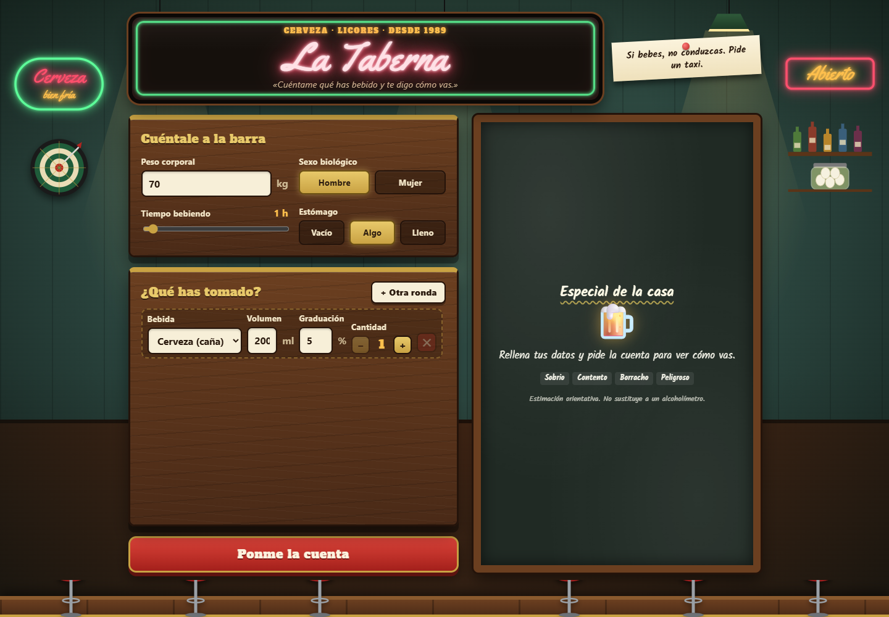
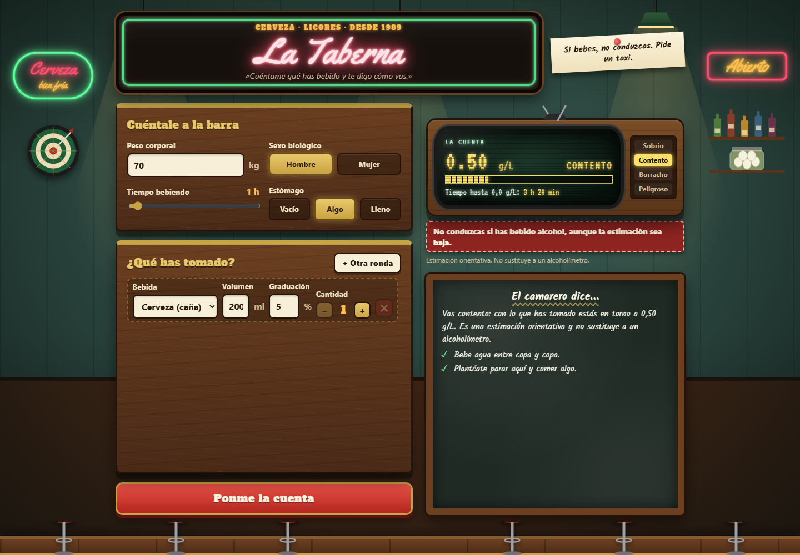
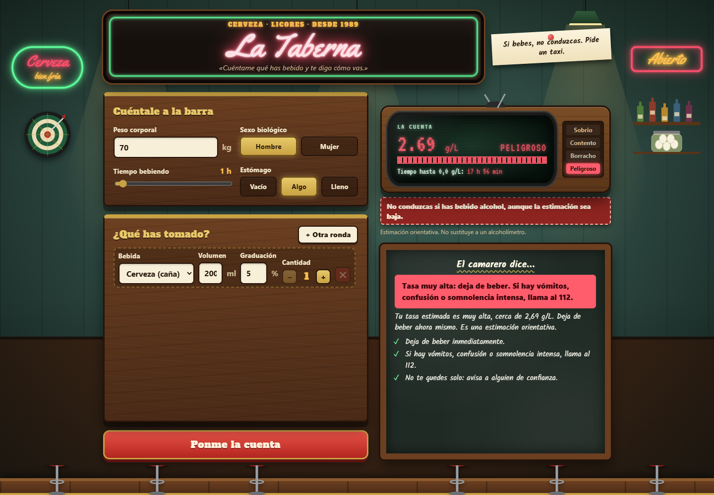
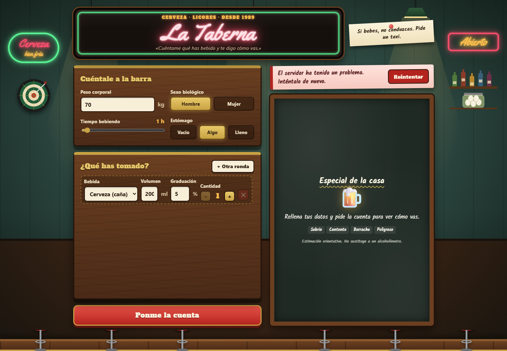
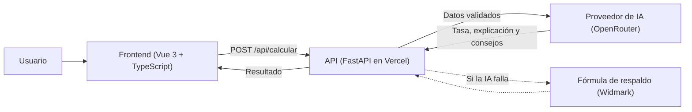
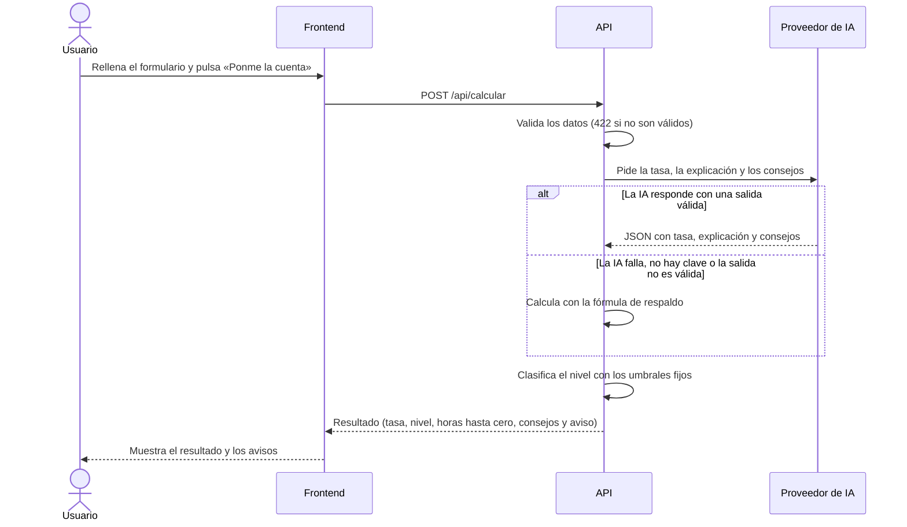

# Especificación de Requisitos del Software (ERS)

## Datos del documento

| Campo | Valor |
|---|---|
| Nombre del proyecto | La Taberna: calculadora de nivel de alcohol en sangre |
| Autores | Daniel Mouimi, Manuel Palomares |
| Curso y grupo | Pendiente |
| Asignatura o módulo | Pendiente |
| Docente | Pendiente |
| Fecha | 15/10/2026 |
| Versión | 0.1 |
| Estado | Borrador |

### Historial de cambios

| Versión | Fecha | Autor | Cambios realizados |
|---|---|---|---|
| 0.1 | 15/10/2026 | Daniel Mouimi, Manuel Palomares | Primera versión del documento. |

## 1. Introducción

### 1.1. Propósito del documento

Esta ERS define qué debe hacer La Taberna y las condiciones que debe cumplir. La utilizarán el equipo de desarrollo (Daniel Mouimi, frontend, y Manuel Palomares, backend) como referencia común, y el docente para evaluar el proyecto. Describe el comportamiento esperado del sistema, no su implementación.

### 1.2. Problema y objetivos

**Problema o necesidad:** quien bebe alcohol suele no saber cuánto alcohol tiene en sangre ni cuánto tardará en eliminarlo, y tiende a subestimar su estado. Sin una referencia sencilla, puede tomar malas decisiones, como seguir bebiendo o conducir. Se necesita una herramienta accesible que, a partir de lo bebido y de los datos de la persona, dé una estimación comprensible y avise de los riesgos.

| ID | Objetivo del proyecto | Indicador de logro |
|---|---|---|
| OBJ-01 | Estimar la tasa de alcohol en sangre (g/L) a partir de las bebidas, el peso, el sexo, el tiempo transcurrido y el estado del estómago. | Para un conjunto de casos de prueba, la tasa devuelta coincide con la calculada a mano con la fórmula de Widmark (tolerancia de ±0,05 g/L). |
| OBJ-02 | Traducir la tasa a un nivel comprensible (sobrio, alegre, borracho o peligroso) y estimar las horas hasta volver a 0,0 g/L. | Cada resultado muestra un nivel y las horas hasta cero, y el nivel corresponde al umbral de la tasa. |
| OBJ-03 | Advertir siempre de que el resultado es orientativo y de que no se debe conducir tras beber. | El aviso aparece en el 100 % de los resultados mostrados. |
| OBJ-04 | Ofrecer una explicación y unos consejos personalizados, sin que su fallo impida obtener el resultado. | Con el servicio de IA no disponible, la aplicación sigue mostrando tasa, nivel y consejos genéricos. |

### 1.3. Alcance

**El sistema incluirá:**

- Un formulario con los datos de la persona: peso, sexo biológico, horas bebiendo y estado del estómago.
- Un registro de una o varias bebidas, con tipo, volumen, graduación y cantidad.
- El cálculo de la tasa de alcohol en sangre, con un mínimo de 0,0 g/L.
- La clasificación en un nivel de embriaguez y la estimación de las horas hasta 0,0 g/L.
- Una explicación y unos consejos en lenguaje sencillo, generados por un modelo de lenguaje.
- Avisos de seguridad: no conducir tras beber, estimación orientativa y, con tasa alta, dejar de beber y pedir ayuda.

**Queda fuera del alcance:**

- Medir el alcohol real con sensores o un alcoholímetro.
- Determinar si una persona puede conducir o está dentro del límite legal.
- Tener en cuenta medicación, enfermedades, tolerancia individual u otras sustancias.
- Guardar historiales o cuentas de usuario.
- Usar la IA para decidir el nivel o los avisos de seguridad: salen de reglas explícitas.

### 1.4. Definiciones y abreviaturas

| Término | Definición |
|---|---|
| ERS | Especificación de Requisitos del Software. |
| TAS | Tasa de alcohol en sangre, expresada en gramos de alcohol por litro de sangre (g/L). |
| Fórmula de Widmark | Método para estimar la TAS: gramos de alcohol / (peso en kg × coeficiente de distribución). |
| Coeficiente de distribución | Reparto del alcohol en el cuerpo: aproximadamente 0,68 en hombres y 0,55 en mujeres. |
| Nivel de embriaguez | Clasificación de la TAS: sobrio, alegre, borracho o peligroso. |
| LLM / IA | Modelo de lenguaje que calcula la tasa y redacta la explicación y los consejos. |
| API | Interfaz del servidor a la que el frontend envía los datos y de la que recibe el resultado. |
| Fórmula de respaldo | Cálculo propio del servidor que se usa cuando la IA no está disponible. |

### 1.5. Referencias y fuentes

| ID | Fuente | Fecha o versión | Ubicación |
|---|---|---|---|
| FUE-01 | Descripción del proyecto (README: idea, datos, reglas y flujo de uso) | 15/10/2026 | `README.md` del repositorio |
| FUE-02 | Plantilla de ERS de la asignatura | Pendiente | `plantillaERS.md` |
| FUE-03 | Enunciado o requisitos del docente | Pendiente | Pendiente |

## 2. Descripción general del sistema

### 2.1. Contexto y perspectiva del producto

La Taberna es un sistema nuevo e independiente: una aplicación web que no amplía ningún sistema previo. Se compone de un frontend, que se ejecuta en el navegador del usuario, y de un backend, que expone una API. El backend se relaciona con un único sistema externo: el proveedor de modelos de lenguaje (por defecto, OpenRouter), al que consulta para calcular la tasa y redactar la explicación. Los diagramas están en el Anexo D.

```
Usuario (navegador) --> Frontend (Vue) --> API (FastAPI) --> Proveedor de IA (OpenRouter)
                                              |
                                              +--> Fórmula de respaldo (si la IA falla)
```

### 2.2. Personas interesadas y tipos de usuario

| ID | Persona, colectivo o rol | Necesidad o responsabilidad | Permisos y conocimientos relevantes |
|---|---|---|---|
| ACT-01 | Usuario | Conocer cuánto alcohol puede tener en sangre y cuánto tardará en eliminarlo. | Acceso anónimo, sin cuenta. Puede introducir datos y ver el resultado. No requiere conocimientos técnicos. |
| ACT-02 | Servicio de IA (sistema externo) | Calcular la tasa y redactar la explicación y los consejos. | Recibe solo valores validados y devuelve un JSON con una estructura fija. |
| ACT-03 | Equipo de desarrollo | Mantener el sistema y configurar la clave y el modelo de IA. | Acceso al código y a las variables de entorno del servidor. |
| ACT-04 | Docente | Evaluar que el proyecto cumple lo especificado. | Consulta esta ERS y el sistema. |

### 2.3. Funciones principales

Los requisitos detallados se documentan en la sección 3.

- Registrar los datos de la persona y las bebidas tomadas.
- Validar los datos antes de calcular.
- Calcular la tasa de alcohol en sangre y estimar las horas hasta 0,0 g/L.
- Clasificar la tasa en un nivel de embriaguez.
- Mostrar el resultado junto con una explicación y consejos.
- Mostrar avisos de seguridad (no conducir, estimación orientativa y alerta con tasa alta).
- Seguir funcionando con una fórmula propia cuando la IA no está disponible.

### 2.4. Entorno de uso

| Aspecto | Descripción |
|---|---|
| Dispositivos y plataformas | Navegadores web actuales en ordenador y en móvil. Versiones concretas: Pendiente. |
| Condiciones de uso | Uso puntual y en cualquier lugar, con conexión a internet. Sin instalación. |
| Volumen esperado | Pendiente. Se prevé un uso académico y de demostración, con muy pocos usuarios simultáneos. |

### 2.5. Restricciones

Todas las restricciones actuales son decisiones del equipo. Si el docente impone alguna, se marcará aquí.

| ID | Restricción | Origen o justificación |
|---|---|---|
| RES-01 | El frontend se desarrolla con Vue 3, TypeScript y Vite. | Decisión del equipo. |
| RES-02 | El backend se desarrolla en Python con FastAPI y se despliega como función serverless (Vercel). | Decisión del equipo. |
| RES-03 | La IA se consume mediante una API compatible con OpenAI, con un modelo gratuito por defecto, sujeto a los límites del proveedor. | Decisión del equipo: evitar costes. |
| RES-04 | El sistema no almacena datos personales ni historiales, y no tiene cuentas de usuario. | Alcance de la primera versión (sección 1.3). |
| RES-05 | Fecha de entrega. | Pendiente de confirmar con el docente. |

### 2.6. Suposiciones y dependencias

| ID | Tipo | Descripción | Consecuencia si no se cumple |
|---|---|---|---|
| SUP-01 | Suposición | El usuario introduce datos veraces (peso, bebidas y tiempo). | La estimación no refleja su estado real. |
| SUP-02 | Suposición | Los coeficientes de Widmark (0,68 y 0,55) y la eliminación de 0,15 g/L por hora son aceptables para una estimación orientativa. | El resultado puede desviarse en personas con características distintas a la media. |
| DEP-01 | Dependencia | El proveedor de IA está disponible y la clave es válida. | Se usa la fórmula de respaldo y una explicación genérica. |
| DEP-02 | Dependencia | La plataforma de alojamiento y la conexión a internet funcionan. | El sistema no es accesible. |
| DEP-03 | Dependencia | El plan gratuito del proveedor de IA mantiene sus límites de uso. | Más respuestas con la fórmula de respaldo. |

## 3. Requisitos funcionales

Los requisitos funcionales describen las acciones y comportamientos que debe ofrecer el sistema.

**Prioridades:** Alta = imprescindible para la versión prevista; Media = importante, pero puede aplazarse mediante acuerdo; Baja = deseable.

### 3.1. Catálogo de requisitos funcionales

| ID | Nombre | Prioridad | Fuente | Estado |
|---|---|---|---|---|
| RF-01 | Registrar los datos de la persona y las bebidas | Alta | FUE-01 | Propuesto |
| RF-02 | Validar los datos de entrada | Alta | FUE-01 | Propuesto |
| RF-03 | Calcular la tasa, el nivel y el tiempo hasta 0,0 g/L | Alta | FUE-01 | Propuesto |
| RF-04 | Mostrar el resultado y los avisos de seguridad | Alta | FUE-01 | Propuesto |
| RF-05 | Generar la explicación y los consejos, con respaldo si falla la IA | Alta | FUE-01 | Propuesto |
| RF-06 | Informar de los errores y permitir reintentar | Media | FUE-01 | Propuesto |

### 3.2. Fichas de requisitos funcionales

#### RF-01. Registrar los datos de la persona y las bebidas

| Campo | Descripción |
|---|---|
| Enunciado | El sistema deberá permitir que el usuario indique su peso, su sexo biológico, las horas que lleva bebiendo y el estado de su estómago, y que añada, modifique y quite las bebidas tomadas, con su tipo, volumen, graduación y cantidad. |
| Justificación | Estos datos determinan los gramos de alcohol y cómo se reparte y se elimina. |
| Actor | ACT-01 |
| Prioridad | Alta |
| Fuente | FUE-01 |
| Precondiciones | Ninguna. La lista siempre contiene al menos una bebida. |
| Entradas | Persona: peso (30 a 250 kg), sexo (hombre o mujer), horas bebiendo (0 a 24, en pasos de 0,25) y estómago (vacío, algo o lleno). Bebida: tipo (cerveza, vino, licor, cóctel u otro), volumen (1 a 2000 ml), graduación (0 a 100 %) y cantidad (1 a 50). |
| Comportamiento esperado | El formulario muestra valores iniciales (70 kg, hombre, 1 h, algo de comida y una cerveza). Al elegir un tipo de bebida, el sistema carga su volumen y graduación habituales (caña de 200 ml al 5 %, copa de vino de 150 ml al 13 %, chupito de 40 ml al 40 %, cubata de 250 ml al 12 %, otra de 100 ml al 10 %) y conserva la cantidad. El usuario puede cambiarlos. |
| Salidas y postcondiciones | Los datos quedan listos para enviarse al calcular. |
| Errores o alternativas | No se puede quitar la última bebida. La cantidad no baja de 1 ni sube de 50. Si un valor está fuera de rango, se aplica RF-02. |
| Dependencias | RF-02 |

**Criterios de aceptación:**

- **CA-RF01-01:** Dado el formulario abierto, cuando el usuario cambia el peso a 80 kg y el sexo a mujer, entonces el formulario conserva esos valores hasta enviarse.
- **CA-RF01-02:** Dado un usuario con una cerveza en la lista, cuando añade otra bebida, entonces la lista tiene dos bebidas.
- **CA-RF01-03:** Dado un usuario con una sola bebida en la lista, cuando intenta quitarla, entonces la bebida permanece en la lista.

#### RF-02. Validar los datos de entrada

| Campo | Descripción |
|---|---|
| Enunciado | El sistema deberá rechazar una solicitud de cálculo que no incluya todos los campos, cuyos valores no cumplan los rangos definidos o que no tenga entre 1 y 50 bebidas, sin llamar a la IA. |
| Justificación | Evita resultados absurdos y protege el servidor y el servicio de IA. |
| Actor | ACT-01 |
| Prioridad | Alta |
| Fuente | FUE-01 |
| Precondiciones | El usuario ha intentado calcular. |
| Entradas | Los datos de RF-01. |
| Comportamiento esperado | Los rangos se comprueban en el formulario y también en el servidor, con los mismos límites. Los valores en el límite (por ejemplo, 30 kg o 250 kg) se aceptan. Un campo ausente, un texto vacío o formado solo por espacios, o un cuerpo que no sea JSON se rechazan. |
| Salidas y postcondiciones | Si los datos son válidos, se calcula. Si no, no se calcula y no se llama a la IA. |
| Errores o alternativas | El servidor responde con un error de validación (código 422) y el frontend muestra el mensaje según RF-06. |
| Dependencias | RF-01, RF-06 |

**Criterios de aceptación:**

- **CA-RF02-01:** Dada una solicitud con un peso de 30 kg o de 250 kg, cuando se envía, entonces el servidor la acepta y llama una sola vez a la IA.
- **CA-RF02-02:** Dada una solicitud con un peso de 29 kg o de 251 kg, sin bebidas, con 51 bebidas, con un campo ausente o con el sexo vacío, cuando se envía, entonces el servidor responde con un error 422 y no llama a la IA.

#### RF-03. Calcular la tasa, el nivel y el tiempo hasta 0,0 g/L

| Campo | Descripción |
|---|---|
| Enunciado | El sistema deberá calcular la tasa de alcohol en sangre en g/L con la fórmula de Widmark, asignarle un nivel de embriaguez según umbrales fijos y estimar las horas hasta volver a 0,0 g/L, sin devolver nunca una tasa negativa. |
| Justificación | Es el objetivo principal del sistema (OBJ-01 y OBJ-02). |
| Actor | ACT-01 |
| Prioridad | Alta |
| Fuente | FUE-01 |
| Precondiciones | Los datos han superado RF-02. |
| Entradas | Datos de RF-01. |
| Comportamiento esperado | Gramos de alcohol = suma de volumen × graduación/100 × 0,8 × cantidad. Se multiplican por el factor de estómago (vacío 1,0; algo 0,9; lleno 0,75). Pico = gramos / (peso × 0,68 en hombres o 0,55 en mujeres). Tasa = pico − 0,15 × horas, con un mínimo de 0. Nivel: menos de 0,2 sobrio; de 0,2 a menos de 0,8 alegre; de 0,8 a menos de 1,5 borracho; desde 1,5 peligroso. El nivel lo decide el sistema, no la IA. Horas hasta cero = tasa sin redondear / 0,15. La tasa y las horas se redondean a dos decimales. Ejemplo en el Anexo A y casos de prueba en el Anexo E. |
| Salidas y postcondiciones | Una tasa mayor o igual que 0, un nivel y unas horas mayores o iguales que 0. |
| Errores o alternativas | Si la IA calcula la tasa y falla, se aplica RF-05. |
| Dependencias | RF-02, RF-05 |

**Criterios de aceptación:**

- **CA-RF03-01:** Dado un hombre de 70 kg con el estómago vacío, 0 h bebiendo y 3 cañas (200 ml al 5 %), cuando se calcula con la fórmula de respaldo, entonces la tasa es 0,50 g/L, el nivel es alegre y faltan 3,36 h hasta 0,0 g/L.
- **CA-RF03-02:** Dado un hombre de 70 kg con el estómago vacío, 2 h bebiendo y 1 caña (200 ml al 5 %), cuando se calcula, entonces la tasa es 0,00 g/L, el nivel es sobrio y las horas son 0.
- **CA-RF03-03:** Dada una tasa de 1,49 g/L, cuando se clasifica, entonces el nivel es borracho. Con 1,50 g/L es peligroso, y con 0,19 g/L es sobrio.

#### RF-04. Mostrar el resultado y los avisos de seguridad

| Campo | Descripción |
|---|---|
| Enunciado | El sistema deberá mostrar la tasa en g/L, el nivel, una barra de la tasa y el tiempo hasta 0,0 g/L, y acompañarlos siempre del aviso de que no se debe conducir tras beber y de la nota «Estimación orientativa. No sustituye a un alcoholímetro.». Con nivel peligroso, deberá mostrar además una alerta que recomiende dejar de beber y llamar al 112 si hay vómitos, confusión o somnolencia intensa. |
| Justificación | El usuario debe entender el resultado de un vistazo y no usarlo para decidir si puede conducir (OBJ-02 y OBJ-03). |
| Actor | ACT-01 |
| Prioridad | Alta |
| Fuente | FUE-01 |
| Precondiciones | El cálculo ha terminado con éxito. |
| Entradas | Respuesta del servidor. |
| Comportamiento esperado | Muestra la tasa con dos decimales, el nivel (sobrio, contento, borracho o peligroso) resaltado entre los cuatro posibles y el tiempo en horas y minutos, o «Ya estás a 0,0 g/L». Los dos avisos aparecen siempre. La alerta solo aparece con nivel peligroso y se anuncia a los lectores de pantalla. Mientras se calcula, el botón queda desactivado y muestra «Sirviendo…», para evitar envíos duplicados. |
| Salidas y postcondiciones | El resultado queda visible. El usuario puede modificar los datos y volver a calcular. |
| Errores o alternativas | Si no hay resultado, se muestra un panel con la invitación a rellenar los datos. |
| Dependencias | RF-03 |

**Criterios de aceptación:**

- **CA-RF04-01:** Dada una respuesta con tasa 0,62 y nivel alegre, cuando se muestra, entonces aparece «0.62 g/L», el nivel «Contento» resaltado, el aviso de conducción y la nota de estimación orientativa, y no aparece la alerta.
- **CA-RF04-02:** Dada una respuesta con nivel peligroso, cuando se muestra, entonces aparece la alerta con la mención al 112, además de los dos avisos.
- **CA-RF04-03:** Dado un cálculo en curso, cuando el usuario mira el botón, entonces está desactivado y muestra «Sirviendo…».

#### RF-05. Generar la explicación y los consejos, con respaldo si falla la IA

| Campo | Descripción |
|---|---|
| Enunciado | El sistema deberá pedir a un modelo de lenguaje la tasa, una explicación de 2 a 4 frases y de 2 a 4 consejos, enviándole solo valores numéricos y de listas cerradas, y deberá devolver igualmente un resultado completo, con la fórmula propia y consejos genéricos, cuando la IA no esté disponible o responda algo no válido. |
| Justificación | Ofrece una explicación personalizada sin que el fallo de un servicio externo deje al usuario sin resultado (OBJ-04). |
| Actor | ACT-02 |
| Prioridad | Alta |
| Fuente | FUE-01 |
| Precondiciones | Los datos han superado RF-02. |
| Entradas | Datos validados de RF-01. |
| Comportamiento esperado | Hace una sola llamada a la IA por solicitud válida y exige un JSON con tasa, explicación y consejos. Lo valida (tasa entre 0 y 6 g/L, explicación no vacía, de 1 a 6 consejos). Si no hay clave, hay un fallo de red o de HTTP, se agotan 30 s o la respuesta no es válida, usa la fórmula de RF-03, una explicación genérica y consejos propios del nivel. La respuesta indica en `origen` si viene de la IA («ia») o del respaldo («respaldo»). El motivo del fallo se anota en la consola del servidor y, en local, en `logs/errores.txt`, sin datos del usuario ni respuesta de la IA. |
| Salidas y postcondiciones | Explicación y consejos junto al resultado, con el mismo formato en los dos casos. |
| Errores o alternativas | El usuario no ve ningún error por un fallo de la IA. Con nivel peligroso, los consejos genéricos incluyen dejar de beber y llamar al 112. |
| Dependencias | RF-02, RF-03, DEP-01 |

**Criterios de aceptación:**

- **CA-RF05-01:** Dada una respuesta válida de la IA, cuando el sistema la recibe, entonces muestra su explicación y sus consejos, `origen` es «ia» y se ha hecho una sola llamada.
- **CA-RF05-02:** Dado un fallo de la IA (sin clave, error 401, 429 o 500, tiempo agotado, respuesta sin JSON o con una tasa de 8 g/L), cuando se solicita un cálculo válido, entonces responde con tasa, nivel, horas hasta cero, explicación y consejos, con `origen` igual a «respaldo».
- **CA-RF05-03:** Dado un fallo de la IA, cuando el servidor lo gestiona, entonces anota el motivo en la consola y en el archivo, sin la clave ni los datos de la solicitud, y la respuesta al usuario no incluye la clave ni errores internos.

#### RF-06. Informar de los errores y permitir reintentar

| Campo | Descripción |
|---|---|
| Enunciado | El sistema deberá mostrar un mensaje comprensible cuando no pueda completar el cálculo y ofrecer un botón para reintentar. |
| Justificación | El usuario debe saber qué ha pasado y poder continuar. |
| Actor | ACT-01 |
| Prioridad | Media |
| Fuente | FUE-01 |
| Precondiciones | La petición al servidor ha fallado. |
| Entradas | Código de error o ausencia de conexión. |
| Comportamiento esperado | Mensajes: 422, datos no válidos; 500, problema del servidor; 502, el servicio de explicación no responde; sin conexión, comprobar la red; otros códigos, error del servidor con su código. |
| Salidas y postcondiciones | Se oculta el resultado anterior y se muestra el error. «Reintentar» repite el cálculo con los datos actuales. |
| Errores o alternativas | Ninguna. |
| Dependencias | RF-02 |

**Criterios de aceptación:**

- **CA-RF06-01:** Dado un servidor inalcanzable, cuando el usuario pide el cálculo, entonces aparece el mensaje de falta de conexión y el botón «Reintentar».
- **CA-RF06-02:** Dado un error mostrado, cuando el usuario pulsa «Reintentar», entonces se repite el cálculo con los datos actuales del formulario.

## 4. Requisitos no funcionales

Describen propiedades de calidad y condiciones de funcionamiento. Los umbrales numéricos son propuestas del equipo y se confirmarán con el docente.

| ID | Categoría | Requisito medible | Condiciones de comprobación | Criterio de aceptación | Prioridad |
|---|---|---|---|---|---|
| RNF-01 | Seguridad y privacidad | La clave de la IA solo existirá en el servidor, el sistema no almacenará los datos del usuario y el registro de errores no contendrá datos del usuario ni respuestas de la IA. | Revisión del código y del repositorio, revisión del tráfico entre el navegador y el servidor, y prueba del registro con un fallo simulado. | La clave no aparece en el repositorio, en el código del frontend ni en las respuestas de la API. El sistema no guarda datos entre solicitudes. El registro solo contiene el motivo del fallo. | Alta |
| RNF-02 | Fiabilidad y rendimiento | Un fallo del proveedor de IA no deberá impedir obtener el resultado. El sistema esperará como máximo 30 segundos a la IA antes de usar el respaldo, y con el respaldo responderá en un máximo de 1 segundo. | Simular falta de clave, error 401, 429 y 500, tiempo agotado y respuesta no válida. Medir 50 solicitudes válidas con el respaldo en local. | En todos los fallos el sistema devuelve un resultado completo y el usuario no ve un error. Al menos el 95 % de las 50 solicitudes con el respaldo tarda 1 s o menos. | Alta |
| RNF-03 | Usabilidad, accesibilidad y compatibilidad | Todos los campos deberán tener etiqueta y ser utilizables con el teclado, el resultado y los errores deberán anunciarse a los lectores de pantalla, y la aplicación deberá funcionar en las versiones actuales de Chrome, Firefox, Edge y Safari y en pantallas de móvil. | Un usuario sin experiencia previa, en ordenador y en móvil (360 px de ancho), y un recorrido con el teclado y con un lector de pantalla. Versiones de los navegadores: Pendiente de acordar. | El usuario completa un cálculo sin ayuda en cada navegador, todos los campos tienen etiqueta, el resultado y las alertas se anuncian y no hay desplazamiento horizontal en móvil. | Media |
| RNF-04 | Mantenibilidad y pruebas | La lógica de cálculo, la validación de entradas, la interpretación de la respuesta de la IA y el manejo de sus fallos deberán tener pruebas automáticas que no llamen a la IA real. | Ejecución de las pruebas del backend y del frontend en el entorno de desarrollo, con la IA simulada. | Todas las pruebas automáticas pasan y ninguna consume créditos de IA. | Media |

## 5. Datos y reglas de negocio

### 5.1. Información que gestionará el sistema

El sistema no guarda ningún dato entre solicitudes (RES-04). Los datos existen solo mientras dura una petición y en la pantalla del usuario.

| ID | Entidad o conjunto de datos | Campos principales | Validaciones | Acceso y conservación |
|---|---|---|---|---|
| DAT-01 | Persona | Peso (kg, entero), sexo (hombre o mujer), horas bebiendo (decimal), estómago (vacío, algo o lleno). | Peso de 30 a 250. Horas de 0 a 24. Sexo y estómago, solo los valores de la lista. Todos obligatorios. | El usuario los introduce. No se conservan. |
| DAT-02 | Bebida | Tipo (cerveza, vino, licor, cóctel u otro), volumen (ml, entero), graduación (% vol., decimal), cantidad (entero). | Volumen de 1 a 2000. Graduación de 0 a 100. Cantidad de 1 a 50. Todos obligatorios. | El usuario las introduce. No se conservan. |
| DAT-03 | Solicitud de cálculo | Los campos de DAT-01 y una lista de DAT-02. | Entre 1 y 50 bebidas. | Viaja del navegador al servidor. No se conserva. |
| DAT-04 | Resultado | Tasa (g/L, mayor o igual que 0), nivel, horas hasta cero (mayor o igual que 0), explicación, lista de consejos, aviso de conducción y origen (ia o respaldo). | La tasa y las horas se redondean a dos decimales. | Se muestra al usuario. No se conserva. |
| DAT-05 | Respuesta de la IA | Tasa, explicación (1 a 2000 caracteres) y consejos (1 a 6). | La tasa debe estar entre 0 y 6 g/L. Si no cumple el formato, se descarta. | Solo se usa para construir DAT-04. No se conserva. |

### 5.2. Reglas de negocio

| ID | Regla | Requisitos relacionados | Fuente |
|---|---|---|---|
| RN-01 | La densidad del alcohol es 0,8 g/ml. Los gramos de alcohol de una bebida son volumen × graduación/100 × 0,8 × cantidad. | RF-03 | FUE-01 |
| RN-02 | El coeficiente de distribución es 0,68 para hombres y 0,55 para mujeres. | RF-03 | FUE-01 |
| RN-03 | El factor de estómago es 1,0 si está vacío, 0,9 con algo de comida y 0,75 si está lleno. | RF-03 | FUE-01 |
| RN-04 | La eliminación del alcohol es de 0,15 g/L por hora. | RF-03 | FUE-01 |
| RN-05 | La tasa nunca es negativa: el mínimo es 0,0 g/L. | RF-03 | FUE-01 |
| RN-06 | Los niveles son: menos de 0,2 sobrio; menos de 0,8 alegre; menos de 1,5 borracho; desde 1,5 peligroso. | RF-03 | FUE-01 |
| RN-07 | El nivel y los avisos de seguridad los decide el sistema con reglas, nunca la IA. | RF-03, RF-04 | FUE-01 |
| RN-08 | Siempre se avisa de que no se debe conducir tras beber y de que el resultado es una estimación orientativa. | RF-04 | FUE-01 |
| RN-09 | Una solicitud necesita al menos una bebida. | RF-01, RF-02 | FUE-01 |
| RN-10 | Una tasa de la IA superior a 6 g/L se considera un error y se descarta. | RF-05 | Decisión del equipo |
| RN-11 | A la IA solo se le envían números y valores de listas cerradas, nunca texto libre del usuario. | RF-05 | Decisión del equipo |

## 6. Interfaces externas

### 6.1. Interfaz de usuario

La interfaz es una sola página con la estética de una taberna. Está dividida en una columna con el formulario y otra con el resultado.

| ID | Pantalla o interacción | Usuarios | Información y acciones necesarias | Requisitos relacionados |
|---|---|---|---|---|
| IU-01 | Cabecera | ACT-01 | Rótulo «La Taberna», lema y el cartel «Si bebes, no conduzcas». | RF-04 |
| IU-02 | Formulario de la persona | ACT-01 | Peso, selección de sexo, horas bebiendo y selección de estómago. | RF-01, RF-02, RNF-03 |
| IU-03 | Lista de bebidas | ACT-01 | Por cada bebida: tipo, volumen, graduación, contador de cantidad y botón de quitar. Botón para añadir otra. | RF-01, RF-02, RNF-03 |
| IU-04 | Botón «Ponme la cuenta» | ACT-01 | Envía el formulario. Durante el cálculo se desactiva y muestra «Sirviendo…». | RF-04 |
| IU-05 | Panel de resultado «La cuenta» | ACT-01 | Tasa en g/L, nivel, barra de tasa, tiempo hasta cero, aviso de conducción y nota de estimación. | RF-03, RF-04 |
| IU-06 | Panel «El camarero dice…» | ACT-01 | Explicación, consejos y, con nivel peligroso, la alerta del 112. | RF-04, RF-05 |
| IU-07 | Tarjeta de error | ACT-01 | Mensaje del error y botón «Reintentar». | RF-06 |
| IU-08 | Panel inicial vacío | ACT-01 | Invitación a rellenar los datos, los cuatro niveles y la nota de estimación. | RF-04 |

Las capturas de la aplicación están en el Anexo C. Son orientativas: el diseño final es el de la aplicación.

### 6.2. Interfaces con otros sistemas o dispositivos

| ID | Sistema o dispositivo externo | Información intercambiada | Dirección y momento del intercambio | Formato o protocolo exigido | Respuesta ante fallos |
|---|---|---|---|---|---|
| INT-01 | Proveedor de IA (por defecto, OpenRouter) | Envía los datos validados en un prompt. Recibe la tasa, la explicación y los consejos. | Ambas, en cada cálculo válido. | HTTPS, `POST /chat/completions` compatible con OpenAI, autenticación con clave en cabecera y respuesta en JSON. Tiempo máximo de 30 s. | Se aplica RF-05 (fórmula de respaldo). |
| INT-02 | Frontend y API propia | Envía la solicitud de cálculo (DAT-03) y recibe el resultado (DAT-04). | Ambas, al pulsar «Ponme la cuenta». | HTTPS, `POST /api/calcular` con JSON. También existe `GET /api/health`, que devuelve `{"status": "ok"}`. | Códigos 422, 500 y 502, o falta de conexión, según RF-06. |

## 7. Casos de uso o escenarios de usuario

### CU-01. Calcular mi tasa de alcohol

| Campo | Descripción |
|---|---|
| Objetivo | Saber cuánto alcohol puede tener en sangre y cuánto tardará en bajar. |
| Actor principal | ACT-01 |
| Precondiciones | La aplicación está abierta y hay conexión con el servidor. |
| Evento de inicio | El usuario abre la página. |
| Requisitos relacionados | RF-01 a RF-05, RN-01 a RN-09, RNF-02 |

**Flujo principal:**

1. El usuario indica su peso, sexo, horas bebiendo y estómago.
2. El usuario elige el tipo de cada bebida, ajusta los datos y la cantidad y, si hace falta, añade más.
3. El usuario pulsa «Ponme la cuenta».
4. El sistema valida los datos y desactiva el botón.
5. El sistema pide el cálculo y la explicación a la IA, y clasifica el nivel con sus reglas.
6. El sistema muestra la tasa, el nivel, el tiempo hasta cero, la explicación, los consejos y los avisos de seguridad.
7. El usuario puede cambiar los datos y volver a calcular.

**Flujos alternativos y excepciones:**

- **A1 — Datos no válidos:** en el paso 4, si algún valor está fuera de rango, el formulario no se envía y el usuario corrige el dato. El flujo continúa en el paso 3.
- **A2 — IA no disponible:** en el paso 5, si la IA falla, el sistema usa la fórmula de respaldo (CU-02). El flujo continúa en el paso 6.
- **A3 — Error del servidor:** en el paso 5, si el servidor no responde o devuelve un error, el sistema muestra el mensaje y el botón «Reintentar». Si el usuario reintenta, el flujo vuelve al paso 4.

**Postcondiciones:** si se completa, el resultado queda visible y no se guarda nada. Si falla, se muestra el error y el usuario conserva los datos del formulario.

### CU-02. Obtener el resultado con la IA caída

| Campo | Descripción |
|---|---|
| Objetivo | Obtener igualmente la estimación cuando falla el servicio de IA. |
| Actor principal | ACT-01 |
| Precondiciones | Los datos son válidos y la IA no está disponible, o no hay clave, o responde de forma no válida. |
| Evento de inicio | El usuario pulsa «Ponme la cuenta». |
| Requisitos relacionados | RF-03, RF-04, RF-05, RNF-02 |

**Flujo principal:**

1. El sistema intenta obtener la tasa y la explicación de la IA.
2. El sistema detecta el fallo y lo registra en el log del servidor.
3. El sistema calcula la tasa con la fórmula de Widmark y clasifica el nivel.
4. El sistema responde con una explicación genérica y los consejos propios del nivel.
5. El usuario ve el resultado y los avisos de seguridad, sin mensaje de error.

**Flujos alternativos y excepciones:**

- **A1 — Nivel peligroso:** en el paso 4, los consejos incluyen dejar de beber y llamar al 112, y se muestra la alerta (CU-03).

**Postcondiciones:** el usuario tiene un resultado completo. La explicación es genérica.

### CU-03. Consultar un resultado de nivel peligroso

| Campo | Descripción |
|---|---|
| Objetivo | Recibir un aviso claro cuando la tasa estimada es muy alta. |
| Actor principal | ACT-01 |
| Precondiciones | La tasa calculada es de 1,5 g/L o más. |
| Evento de inicio | El sistema muestra el resultado. |
| Requisitos relacionados | RF-03, RF-04, RN-06, RN-07 |

**Flujo principal:**

1. El sistema clasifica la tasa como peligrosa.
2. El sistema muestra el nivel «Peligroso» resaltado.
3. El sistema muestra la alerta: dejar de beber y llamar al 112 si hay vómitos, confusión o somnolencia intensa.
4. El sistema muestra la explicación, los consejos y los avisos de conducción y de estimación.

**Flujos alternativos y excepciones:**

- **A1 — Nivel inferior:** en el paso 1, si la tasa es menor de 1,5 g/L, no se muestra la alerta.

**Postcondiciones:** el usuario ha visto la alerta de seguridad.

## 8. Verificación y trazabilidad

Los métodos «Automática» se ejecutan con las pruebas del proyecto y los «Manual» se ejecutan siguiendo los pasos indicados. Los datos de los casos de cálculo están en el Anexo E.

| Requisito | Objetivo o necesidad de origen | Criterio de aceptación | ID de prueba | Método y datos de comprobación | Resultado esperado |
|---|---|---|---|---|---|
| RF-01 | OBJ-01, FUE-01 | CA-RF01-01, CA-RF01-02, CA-RF01-03 | PR-01 | Automática en el frontend (`tests/persona.spec.ts` y `tests/bebidas.spec.ts`) y revisión manual del formulario: cambiar peso a 80 kg y sexo a mujer, añadir una bebida y quitar la única bebida. | Los valores se conservan. Con la primera hay dos bebidas. La última no se puede quitar. |
| RF-02 | OBJ-01, FUE-01 | CA-RF02-01, CA-RF02-02 | PR-02 | Automática en la API (`api/test_contrato.py`) con la IA simulada: pesos de 30, 250, 29 y 251 kg, 0, 50 y 51 bebidas, campos ausentes, texto vacío y cuerpo que no es JSON. | Los límites se aceptan con una sola llamada a la IA. El resto da 422 y no llama a la IA. |
| RF-03 | OBJ-01, OBJ-02, FUE-01 | CA-RF03-01, CA-RF03-02, CA-RF03-03 | PR-03 | Automática (`api/test_calculo.py`) con los casos E-01 a E-07 del Anexo E y con las tasas 0,19, 0,20, 1,49 y 1,50. | Las tasas, niveles y horas coinciden con el Anexo E. |
| RF-04 | OBJ-02, OBJ-03, FUE-01 | CA-RF04-01, CA-RF04-02, CA-RF04-03 | PR-04 | Manual con las capturas del Anexo C: caso alegre, caso peligroso y observación del botón durante un cálculo. | Se ven la tasa, el nivel, los dos avisos y, solo con peligroso, la alerta del 112. El botón muestra «Sirviendo…». |
| RF-05 | OBJ-04, FUE-01 | CA-RF05-01, CA-RF05-02, CA-RF05-03 | PR-05 | Automática (`api/test_ia.py` y `api/test_contrato.py`) con la IA simulada: respuesta válida, timeout, error 401, 429 y 500, sin clave, respuesta sin JSON y tasa de 12. | Con la válida, `origen` es «ia». En los fallos, `origen` es «respaldo», el resultado está completo y el registro no lleva datos del usuario. |
| RF-06 | OBJ-04, FUE-01 | CA-RF06-01, CA-RF06-02 | PR-06 | Manual: apagar el servidor, calcular y pulsar «Reintentar». | Mensaje de falta de conexión y repetición del cálculo. |
| RNF-01 | OBJ-04 | Sección 4 | PR-07 | Inspección: buscar la clave en el repositorio, en el código del frontend y en las respuestas. Automática: prueba del registro con un fallo simulado. | Sin coincidencias. El registro solo tiene el motivo. |
| RNF-02 | OBJ-04 | Sección 4 | PR-08 | Automática: fallos simulados de la IA. Medida de 50 solicitudes con el respaldo en local. | Resultado completo en todos los fallos. El 95 % responde en 1 s o menos. |
| RNF-03 | OBJ-02 | Sección 4 | PR-09 | Manual: usuario sin experiencia en ordenador y móvil, recorrido con teclado y cálculo en Chrome, Firefox, Edge y Safari. | Cálculo sin ayuda, campos con etiqueta y sin desplazamiento horizontal. |
| RNF-04 | OBJ-01 | Sección 4 | PR-10 | Automática: ejecutar las pruebas del backend (`pytest`) y del frontend (`npm test`). | Todas pasan, sin llamar a la IA real. |

## 9. Cuestiones pendientes

| ID | Duda o decisión pendiente | Requisitos afectados | Responsable de resolverla | Fecha prevista | Resolución |
|---|---|---|---|---|---|
| PEN-01 | Curso y grupo, asignatura y docente de los datos del documento. | Datos del documento | Daniel Mouimi y Manuel Palomares | Pendiente | Pendiente |
| PEN-02 | Enunciado o requisitos del docente (FUE-03) y su posible conflicto con las decisiones del equipo. | Todos, RES-01 a RES-05 | Equipo | Pendiente | Pendiente |
| PEN-03 | Confirmar los umbrales propuestos, como 1 s y el 95 % de 50 solicitudes. | RNF-02 | Equipo y docente | Pendiente | Pendiente |
| PEN-04 | Versiones de navegadores y volumen de usuarios esperado. | RNF-03, sección 2.4 | Equipo | Pendiente | Pendiente |
| PEN-05 | Fecha de entrega. | RES-05 | Docente | Pendiente | Pendiente |
| PEN-06 | Tolerancia admitida entre la tasa que calcula la IA y la de la fórmula. Hoy se acepta cualquiera hasta 6 g/L. | RF-03, RF-05, RN-10 | Equipo | Pendiente | Pendiente |
| PEN-07 | El README sitúa el aviso de ayuda urgente con el resultado, y en la aplicación está en el panel de la explicación. Decidir cuál es lo correcto y actualizar el documento que corresponda. | RF-04 | Equipo | Pendiente | Pendiente |
| PEN-08 | Comprobar si el formulario limita a 50 bebidas, como hace el servidor. Si no, añadir el límite o un mensaje claro. | RF-01, RF-02 | Daniel Mouimi | Pendiente | Pendiente |

## 10. Revisión y conformidad

### 10.1. Lista de comprobación antes de entregar

- [x] El problema, los objetivos y los límites del sistema están definidos.
- [x] Se identifican los usuarios y sus permisos.
- [x] Cada requisito tiene un identificador único.
- [ ] Los requisitos son claros, necesarios y no se contradicen. (Pendiente de revisión por el equipo.)
- [x] Cada requisito funcional expresa una obligación y tiene criterios de aceptación verificables.
- [x] Se contemplan los errores y los casos límite relevantes.
- [x] Los requisitos no funcionales incluyen medidas y condiciones de comprobación.
- [x] Los datos, las reglas de negocio y las interfaces están descritos.
- [x] Todos los requisitos están relacionados con su origen y su comprobación.
- [ ] Las dudas pendientes están identificadas y tienen un responsable. (Falta fijar las fechas.)
- [ ] Se han sustituido los marcadores, eliminado los ejemplos y justificado los apartados que no aplican. (Quedan campos «Pendiente», recogidos en la sección 9.)
- [ ] Se han actualizado la fecha, la versión y el historial de cambios. (Revisar antes de entregar.)

### 10.2. Registro de revisión

| Revisor y rol | Versión revisada | Fecha | Resultado | Observaciones |
|---|---|---|---|---|
| Pendiente | 0.1 | Pendiente | Pendiente | Sin revisión todavía. |

## Anexos

### Anexo A. Ejemplo de cálculo

Datos: hombre de 70 kg, estómago vacío, 0 h bebiendo, 3 cañas (200 ml al 5 %).

1. Gramos de alcohol: 200 × 5/100 × 0,8 × 3 = 24 g.
2. Factor de estómago (vacío): 24 × 1,0 = 24 g.
3. Pico: 24 / (70 × 0,68) = 0,504 g/L.
4. Tasa: 0,504 − 0,15 × 0 = 0,504 g/L, que se muestra como 0,50 g/L.
5. Nivel: alegre (entre 0,2 y 0,8).
6. Tiempo hasta 0,0 g/L: 0,504 / 0,15 = 3,36 h (3 h 22 min). Con la tasa ya redondeada (0,50) saldrían 3,33 h.

### Anexo B. Contrato de la API

Petición `POST /api/calcular`:

```json
{
  "peso_kg": 70,
  "sexo": "hombre",
  "tiempo_horas": 0,
  "estomago": "vacio",
  "bebidas": [
    { "tipo": "cerveza", "volumen_ml": 200, "graduacion": 5, "cantidad": 3 }
  ]
}
```

Respuesta:

```json
{
  "tasa_gl": 0.5,
  "nivel": "alegre",
  "horas_hasta_cero": 3.33,
  "explicacion": "Texto de la explicación.",
  "consejos": ["Consejo 1", "Consejo 2"],
  "aviso_conduccion": "No conduzcas si has bebido alcohol, aunque la estimación sea baja.",
  "origen": "ia"
}
```

### Anexo C. Capturas de la interfaz

Capturas de la aplicación en cuatro situaciones. Son orientativas: el diseño final es el de la aplicación. Las respuestas del servidor de las capturas 2 a 4 son simuladas, para no consumir la IA.

**C.1. Pantalla inicial** (IU-02, IU-03, IU-04 e IU-08). Formulario con los valores por defecto y el panel vacío.



**C.2. Resultado de nivel alegre** (RF-04 e IU-05, IU-06). Tasa, nivel, tiempo hasta cero, avisos, explicación y consejos.



**C.3. Resultado de nivel peligroso** (RF-04 e IU-06). Se añade la alerta que recomienda dejar de beber y llamar al 112.



**C.4. Error del servidor** (RF-06 e IU-07). Mensaje y botón «Reintentar».



### Anexo D. Diagramas de arquitectura

**D.1. Componentes y flujo de datos** (sección 2.1):



**D.2. Secuencia de un cálculo** (CU-01 y CU-02):



### Anexo E. Casos de prueba de cálculo

Resultados calculados con la fórmula de Widmark de la sección 5.2, que es la misma que usa la fórmula de respaldo. El tiempo hasta cero se obtiene dividiendo la tasa sin redondear entre 0,15 y se redondea después. Por eso, a partir de la tasa ya redondeada (RF-03) pueden salir centésimas distintas. Se usan en la prueba PR-03 (RF-03).

| Caso | Persona | Bebidas | Horas | Gramos tras el estómago | Tasa (g/L) | Nivel | Horas hasta 0,0 |
|---|---|---|---|---|---|---|---|
| E-01 | Hombre, 70 kg, estómago vacío | 3 cañas (200 ml, 5 %) | 0 | 24,00 | 0,50 | Alegre | 3,36 |
| E-02 | Hombre, 70 kg, estómago vacío | 1 caña (200 ml, 5 %) | 2 | 8,00 | 0,00 | Sobrio | 0,00 |
| E-03 | Mujer, 60 kg, estómago vacío | 1 caña (200 ml, 5 %) | 0 | 8,00 | 0,24 | Alegre | 1,62 |
| E-04 | Hombre, 80 kg, algo de comida | 2 copas de vino (150 ml, 13 %) | 1 | 28,08 | 0,37 | Alegre | 2,44 |
| E-05 | Hombre, 75 kg, estómago vacío | 6 cañas (200 ml, 5 %) | 0 | 48,00 | 0,94 | Borracho | 6,27 |
| E-06 | Hombre, 70 kg, estómago vacío | 10 chupitos (40 ml, 40 %) | 0 | 128,00 | 2,69 | Peligroso | 17,93 |
| E-07 | Mujer, 55 kg, estómago lleno | 4 cubatas (250 ml, 12 %) | 0 | 72,00 | 2,38 | Peligroso | 15,87 |

Los casos E-01 y E-02 son los de CA-RF03-01 y CA-RF03-02. Los casos E-05 y E-06 sirven para comprobar los niveles de RF-03, y el caso E-06 es también el de la captura C.3.
