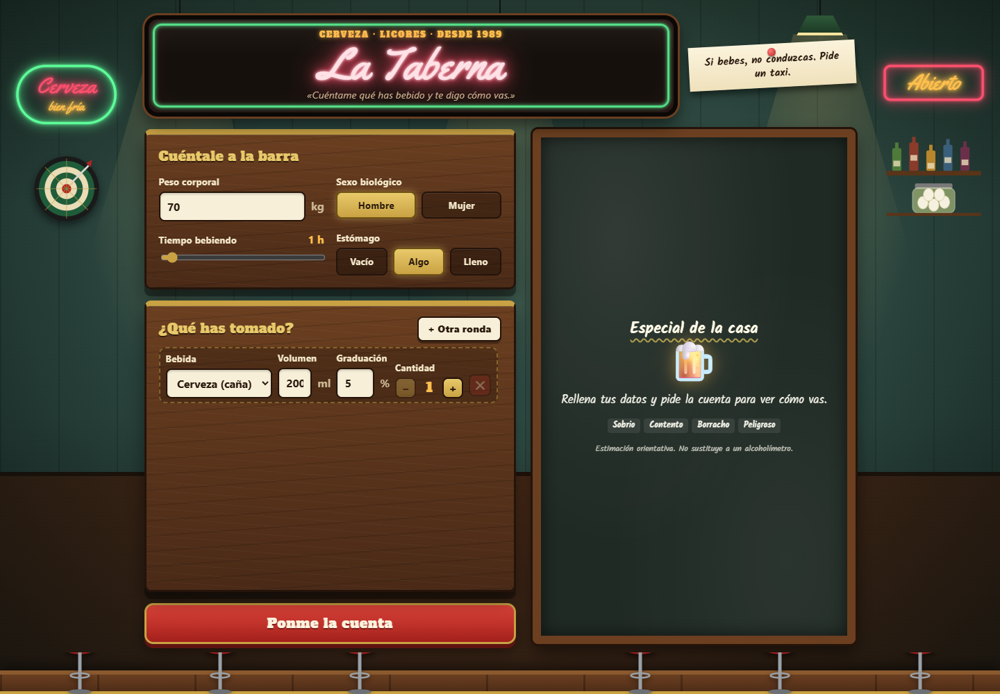
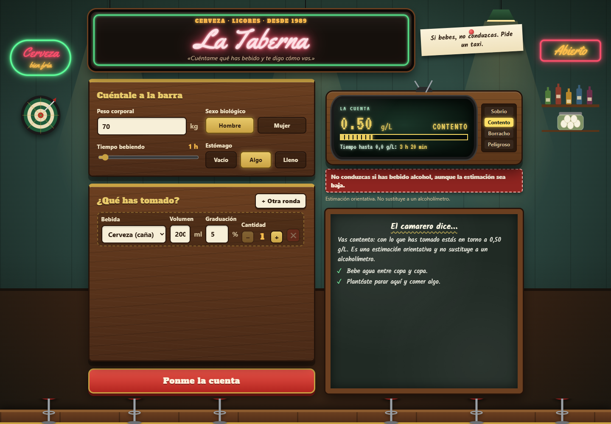
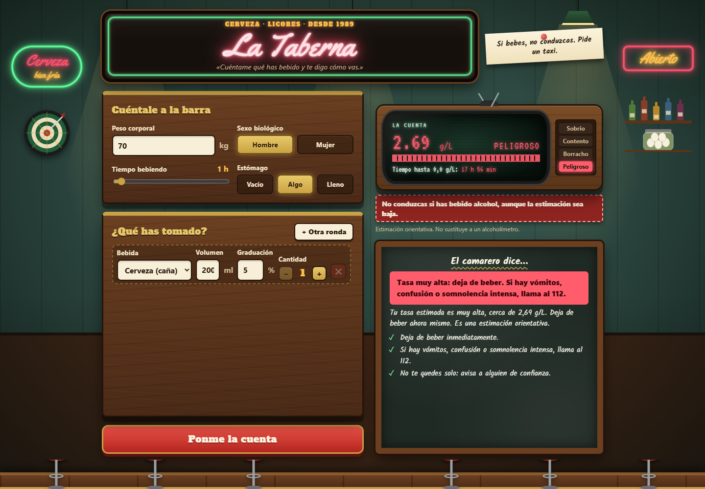
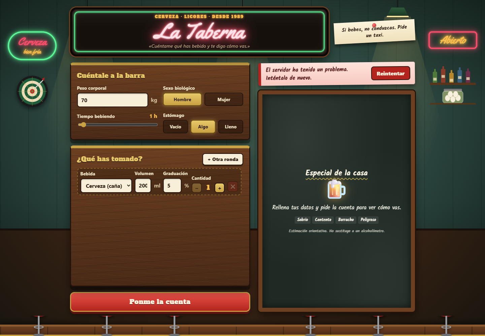
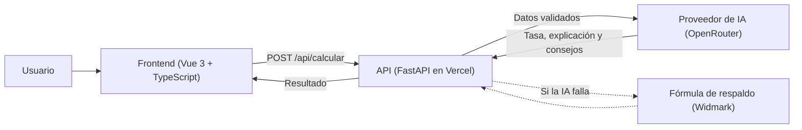
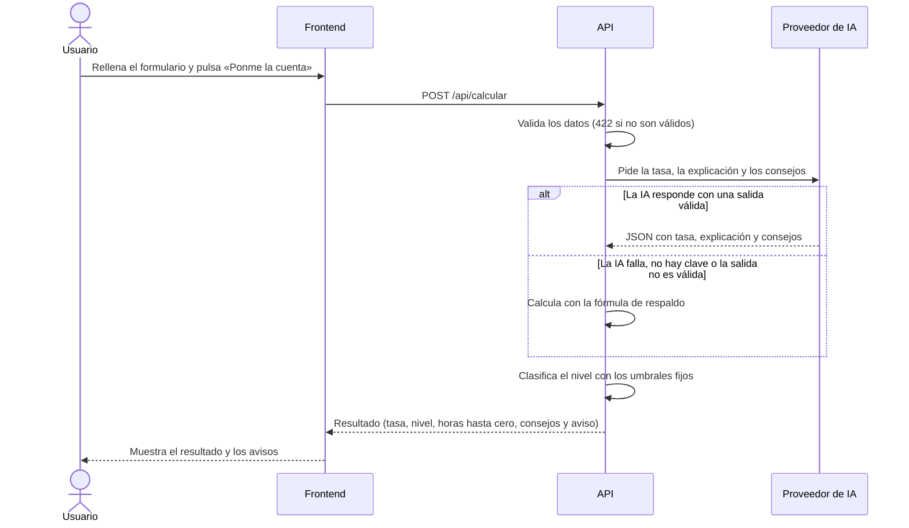

# Especificación de Requisitos del Software (ERS)

## Datos del documento

| Campo | Valor |
|---|---|
| Nombre del proyecto | La Taberna: calculadora de nivel de alcohol en sangre |
| Autores | Daniel Mouimi, Manuel Palomares |
| Curso y grupo | Pendiente |
| Asignatura o módulo | Pendiente |
| Docente | Pendiente |
| Fecha | 15/10/2026 |
| Versión | 0.1 |
| Estado | Borrador |

### Historial de cambios

| Versión | Fecha | Autor | Cambios realizados |
|---|---|---|---|
| 0.1 | 15/10/2026 | Daniel Mouimi, Manuel Palomares | Primera versión del documento. |

## 1. Introducción

### 1.1. Propósito del documento

Esta ERS define qué debe hacer La Taberna y las condiciones que debe cumplir. La utilizarán el equipo de desarrollo (Daniel Mouimi, frontend, y Manuel Palomares, backend) como referencia común, y el docente para evaluar el proyecto. Describe el comportamiento esperado del sistema, no su implementación.

### 1.2. Problema y objetivos

**Problema o necesidad:** quien bebe alcohol suele no saber cuánto alcohol tiene en sangre ni cuánto tardará en eliminarlo, y tiende a subestimar su estado. Sin una referencia sencilla, puede tomar malas decisiones, como seguir bebiendo o conducir. Se necesita una herramienta accesible que, a partir de lo bebido y de los datos de la persona, dé una estimación comprensible y avise de los riesgos.

| ID | Objetivo del proyecto | Indicador de logro |
|---|---|---|
| OBJ-01 | Estimar la tasa de alcohol en sangre (g/L) a partir de las bebidas, el peso, el sexo, el tiempo transcurrido y el estado del estómago. | Para un conjunto de casos de prueba, la tasa devuelta coincide con la calculada a mano con la fórmula de Widmark (tolerancia de ±0,05 g/L). |
| OBJ-02 | Traducir la tasa a un nivel comprensible (sobrio, alegre, borracho o peligroso) y estimar las horas hasta volver a 0,0 g/L. | Cada resultado muestra un nivel y las horas hasta cero, y el nivel corresponde al umbral de la tasa. |
| OBJ-03 | Advertir siempre de que el resultado es orientativo y de que no se debe conducir tras beber. | El aviso aparece en el 100 % de los resultados mostrados. |
| OBJ-04 | Ofrecer una explicación y unos consejos personalizados, sin que su fallo impida obtener el resultado. | Con el servicio de IA no disponible, la aplicación sigue mostrando tasa, nivel y consejos genéricos. |

### 1.3. Alcance

**El sistema incluirá:**

- Un formulario con los datos de la persona: peso, sexo biológico, horas bebiendo y estado del estómago.
- Un registro de una o varias bebidas, con tipo, volumen, graduación y cantidad.
- El cálculo de la tasa de alcohol en sangre, con un mínimo de 0,0 g/L.
- La clasificación en un nivel de embriaguez y la estimación de las horas hasta 0,0 g/L.
- Una explicación y unos consejos en lenguaje sencillo, generados por un modelo de lenguaje.
- Avisos de seguridad: no conducir tras beber, estimación orientativa y, con tasa alta, dejar de beber y pedir ayuda.

**Queda fuera del alcance:**

- Medir el alcohol real con sensores o un alcoholímetro.
- Determinar si una persona puede conducir o está dentro del límite legal.
- Tener en cuenta medicación, enfermedades, tolerancia individual u otras sustancias.
- Guardar historiales o cuentas de usuario.
- Usar la IA para decidir el nivel o los avisos de seguridad: salen de reglas explícitas.

### 1.4. Definiciones y abreviaturas

| Término | Definición |
|---|---|
| ERS | Especificación de Requisitos del Software. |
| TAS | Tasa de alcohol en sangre, expresada en gramos de alcohol por litro de sangre (g/L). |
| Fórmula de Widmark | Método para estimar la TAS: gramos de alcohol / (peso en kg × coeficiente de distribución). |
| Coeficiente de distribución | Reparto del alcohol en el cuerpo: aproximadamente 0,68 en hombres y 0,55 en mujeres. |
| Nivel de embriaguez | Clasificación de la TAS: sobrio, alegre, borracho o peligroso. |
| LLM / IA | Modelo de lenguaje que calcula la tasa y redacta la explicación y los consejos. |
| API | Interfaz del servidor a la que el frontend envía los datos y de la que recibe el resultado. |
| Fórmula de respaldo | Cálculo propio del servidor que se usa cuando la IA no está disponible. |

### 1.5. Referencias y fuentes

| ID | Fuente | Fecha o versión | Ubicación |
|---|---|---|---|
| FUE-01 | Descripción del proyecto (README: idea, datos, reglas y flujo de uso) | 15/10/2026 | `README.md` del repositorio |
| FUE-02 | Plantilla de ERS de la asignatura | Pendiente | `plantillaERS.md` |
| FUE-03 | Enunciado o requisitos del docente | Pendiente | Pendiente |

## 2. Descripción general del sistema

### 2.1. Contexto y perspectiva del producto

La Taberna es un sistema nuevo e independiente: una aplicación web que no amplía ningún sistema previo. Se compone de un frontend, que se ejecuta en el navegador del usuario, y de un backend, que expone una API. El backend se relaciona con un único sistema externo: el proveedor de modelos de lenguaje (por defecto, OpenRouter), al que consulta para calcular la tasa y redactar la explicación. Los diagramas están en el Anexo D.

```
Usuario (navegador) --> Frontend (Vue) --> API (FastAPI) --> Proveedor de IA (OpenRouter)
                                              |
                                              +--> Fórmula de respaldo (si la IA falla)
```

### 2.2. Personas interesadas y tipos de usuario

| ID | Persona, colectivo o rol | Necesidad o responsabilidad | Permisos y conocimientos relevantes |
|---|---|---|---|
| ACT-01 | Usuario | Conocer cuánto alcohol puede tener en sangre y cuánto tardará en eliminarlo. | Acceso anónimo, sin cuenta. Puede introducir datos y ver el resultado. No requiere conocimientos técnicos. |
| ACT-02 | Servicio de IA (sistema externo) | Calcular la tasa y redactar la explicación y los consejos. | Recibe solo valores validados y devuelve un JSON con una estructura fija. |
| ACT-03 | Equipo de desarrollo | Mantener el sistema y configurar la clave y el modelo de IA. | Acceso al código y a las variables de entorno del servidor. |
| ACT-04 | Docente | Evaluar que el proyecto cumple lo especificado. | Consulta esta ERS y el sistema. |

### 2.3. Funciones principales

Los requisitos detallados se documentan en la sección 3.

- Registrar los datos de la persona y las bebidas tomadas.
- Validar los datos antes de calcular.
- Calcular la tasa de alcohol en sangre y estimar las horas hasta 0,0 g/L.
- Clasificar la tasa en un nivel de embriaguez.
- Mostrar el resultado junto con una explicación y consejos.
- Mostrar avisos de seguridad (no conducir, estimación orientativa y alerta con tasa alta).
- Seguir funcionando con una fórmula propia cuando la IA no está disponible.

### 2.4. Entorno de uso

| Aspecto | Descripción |
|---|---|
| Dispositivos y plataformas | Navegadores web actuales en ordenador y en móvil. Versiones concretas: Pendiente. |
| Condiciones de uso | Uso puntual y en cualquier lugar, con conexión a internet. Sin instalación. |
| Volumen esperado | Pendiente. Se prevé un uso académico y de demostración, con muy pocos usuarios simultáneos. |

### 2.5. Restricciones

Todas las restricciones actuales son decisiones del equipo. Si el docente impone alguna, se marcará aquí.

| ID | Restricción | Origen o justificación |
|---|---|---|
| RES-01 | El frontend se desarrolla con Vue 3, TypeScript y Vite. | Decisión del equipo. |
| RES-02 | El backend se desarrolla en Python con FastAPI y se despliega como función serverless (Vercel). | Decisión del equipo. |
| RES-03 | La IA se consume mediante una API compatible con OpenAI, con un modelo gratuito por defecto, sujeto a los límites del proveedor. | Decisión del equipo: evitar costes. |
| RES-04 | El sistema no almacena datos personales ni historiales, y no tiene cuentas de usuario. | Alcance de la primera versión (sección 1.3). |
| RES-05 | Fecha de entrega. | Pendiente de confirmar con el docente. |

### 2.6. Suposiciones y dependencias

| ID | Tipo | Descripción | Consecuencia si no se cumple |
|---|---|---|---|
| SUP-01 | Suposición | El usuario introduce datos veraces (peso, bebidas y tiempo). | La estimación no refleja su estado real. |
| SUP-02 | Suposición | Los coeficientes de Widmark (0,68 y 0,55) y la eliminación de 0,15 g/L por hora son aceptables para una estimación orientativa. | El resultado puede desviarse en personas con características distintas a la media. |
| DEP-01 | Dependencia | El proveedor de IA está disponible y la clave es válida. | Se usa la fórmula de respaldo y una explicación genérica. |
| DEP-02 | Dependencia | La plataforma de alojamiento y la conexión a internet funcionan. | El sistema no es accesible. |
| DEP-03 | Dependencia | El plan gratuito del proveedor de IA mantiene sus límites de uso. | Más respuestas con la fórmula de respaldo. |

## 3. Requisitos funcionales

Los requisitos funcionales describen las acciones y comportamientos que debe ofrecer el sistema.

**Prioridades:** Alta = imprescindible para la versión prevista; Media = importante, pero puede aplazarse mediante acuerdo; Baja = deseable.

### 3.1. Catálogo de requisitos funcionales

| ID | Nombre | Prioridad | Fuente | Estado |
|---|---|---|---|---|
| RF-01 | Registrar los datos de la persona | Alta | FUE-01 | Propuesto |
| RF-02 | Registrar las bebidas | Alta | FUE-01 | Propuesto |
| RF-03 | Validar los datos de entrada | Alta | FUE-01 | Propuesto |
| RF-04 | Calcular la tasa de alcohol en sangre | Alta | FUE-01 | Propuesto |
| RF-05 | Clasificar el nivel de embriaguez | Alta | FUE-01 | Propuesto |
| RF-06 | Estimar el tiempo hasta 0,0 g/L | Alta | FUE-01 | Propuesto |
| RF-07 | Mostrar el resultado | Alta | FUE-01 | Propuesto |
| RF-08 | Mostrar los avisos de conducción y de estimación | Alta | FUE-01 | Propuesto |
| RF-09 | Mostrar una alerta con tasa peligrosa | Alta | FUE-01 | Propuesto |
| RF-10 | Generar explicación y consejos con IA | Media | FUE-01 | Propuesto |
| RF-11 | Responder sin IA mediante la fórmula de respaldo | Alta | FUE-01 | Propuesto |
| RF-12 | Informar de los errores y permitir reintentar | Media | FUE-01 | Propuesto |

### 3.2. Fichas de requisitos funcionales

#### RF-01. Registrar los datos de la persona

| Campo | Descripción |
|---|---|
| Enunciado | El sistema deberá permitir que el usuario indique su peso, su sexo biológico, las horas que lleva bebiendo y el estado de su estómago. |
| Justificación | Estos datos determinan cómo se reparte y se elimina el alcohol. |
| Actor | ACT-01 |
| Prioridad | Alta |
| Fuente | FUE-01 |
| Precondiciones | Ninguna. |
| Entradas | Peso (30 a 250 kg), sexo (hombre o mujer), horas bebiendo (0 a 24, en pasos de 0,25) y estómago (vacío, algo o lleno). |
| Comportamiento esperado | El sistema muestra los cuatro campos con valores iniciales (70 kg, hombre, 1 h, algo de comida) y refleja los cambios del usuario. |
| Salidas y postcondiciones | Los datos quedan listos para enviarse al calcular. |
| Errores o alternativas | Si un valor está fuera de rango, se aplica RF-03. |
| Dependencias | RF-03 |

**Criterios de aceptación:**

- **CA-RF01-01:** Dado el formulario abierto, cuando el usuario cambia el peso a 80 kg y el sexo a mujer, entonces el formulario conserva esos valores hasta enviarse.
- **CA-RF01-02:** Dado el formulario abierto, cuando el usuario introduce 20 kg de peso, entonces el sistema no permite enviar el formulario.

#### RF-02. Registrar las bebidas

| Campo | Descripción |
|---|---|
| Enunciado | El sistema deberá permitir que el usuario añada, modifique y quite bebidas, indicando para cada una su tipo, volumen, graduación y cantidad. |
| Justificación | Los gramos de alcohol se calculan a partir de cada bebida. |
| Actor | ACT-01 |
| Prioridad | Alta |
| Fuente | FUE-01 |
| Precondiciones | Ninguna. La lista siempre contiene al menos una bebida. |
| Entradas | Tipo (cerveza, vino, licor, cóctel u otro), volumen (1 a 2000 ml), graduación (0 a 100 %) y cantidad (1 a 50). |
| Comportamiento esperado | Al elegir un tipo, el sistema carga su volumen y graduación habituales (caña de 200 ml al 5 %, copa de vino de 150 ml al 13 %, chupito de 40 ml al 40 %, cubata de 250 ml al 12 %, otra de 100 ml al 10 %) y conserva la cantidad. El usuario puede cambiarlos. |
| Salidas y postcondiciones | La lista de bebidas queda lista para enviarse. |
| Errores o alternativas | No se puede quitar la última bebida. La cantidad no baja de 1 ni sube de 50. |
| Dependencias | RF-03 |

**Criterios de aceptación:**

- **CA-RF02-01:** Dado un usuario con una cerveza en la lista, cuando pulsa «añadir», entonces la lista tiene dos bebidas.
- **CA-RF02-02:** Dado un usuario con una sola bebida en la lista, cuando intenta quitarla, entonces la bebida permanece en la lista.

#### RF-03. Validar los datos de entrada

| Campo | Descripción |
|---|---|
| Enunciado | El sistema deberá rechazar una solicitud de cálculo cuyos datos no cumplan los rangos definidos o que no incluya al menos una bebida. |
| Justificación | Evita resultados absurdos y protege el servidor y el servicio de IA. |
| Actor | ACT-01 |
| Prioridad | Alta |
| Fuente | FUE-01 |
| Precondiciones | El usuario ha intentado calcular. |
| Entradas | Los datos de RF-01 y RF-02, con 1 a 50 bebidas. |
| Comportamiento esperado | Los rangos se comprueban en el formulario y también en el servidor, con los mismos límites. |
| Salidas y postcondiciones | Si los datos son válidos, se calcula. Si no, no se calcula y se informa del error. |
| Errores o alternativas | El servidor responde con un error de validación (código 422) y el frontend muestra el mensaje según RF-12. |
| Dependencias | RF-01, RF-02, RF-12 |

**Criterios de aceptación:**

- **CA-RF03-01:** Dada una solicitud con peso de 70 kg y una cerveza de 200 ml al 5 %, cuando se envía, entonces el sistema la acepta y calcula.
- **CA-RF03-02:** Dada una solicitud sin bebidas, o con un peso de 20 kg, cuando se envía al servidor, entonces el servidor la rechaza con un error 422 y no calcula.

#### RF-04. Calcular la tasa de alcohol en sangre

| Campo | Descripción |
|---|---|
| Enunciado | El sistema deberá calcular la tasa de alcohol en sangre en g/L a partir de las bebidas, el peso, el sexo, el tiempo y el estómago, con la fórmula de Widmark, y nunca devolver un valor negativo. |
| Justificación | Es el objetivo principal del sistema (OBJ-01). |
| Actor | ACT-01 |
| Prioridad | Alta |
| Fuente | FUE-01 |
| Precondiciones | Los datos han superado RF-03. |
| Entradas | Datos de RF-01 y RF-02. |
| Comportamiento esperado | Gramos de alcohol = suma de volumen × graduación/100 × 0,8 × cantidad. Se multiplican por el factor de estómago (vacío 1,0; algo 0,9; lleno 0,75). Pico = gramos / (peso × 0,68 en hombres o 0,55 en mujeres). Tasa = pico − 0,15 × horas, con un mínimo de 0. El resultado se redondea a dos decimales. Ejemplo en el Anexo A y casos de prueba en el Anexo E. |
| Salidas y postcondiciones | Una tasa en g/L mayor o igual que 0. |
| Errores o alternativas | Si la IA falla, se aplica RF-11. |
| Dependencias | RF-03, RF-10, RF-11 |

**Criterios de aceptación:**

- **CA-RF04-01:** Dado un hombre de 70 kg con el estómago vacío, 0 h bebiendo y 3 cañas (200 ml al 5 %), cuando se calcula con la fórmula de respaldo, entonces la tasa es 0,50 g/L.
- **CA-RF04-02:** Dado un hombre de 70 kg con el estómago vacío, 2 h bebiendo y 1 caña (200 ml al 5 %), cuando se calcula, entonces la tasa es 0,00 g/L y no es negativa.

#### RF-05. Clasificar el nivel de embriaguez

| Campo | Descripción |
|---|---|
| Enunciado | El sistema deberá asignar a la tasa un nivel de embriaguez según umbrales fijos, y no según lo que indique la IA. |
| Justificación | El nivel y los avisos de seguridad deben salir de reglas explícitas (OBJ-02). |
| Actor | ACT-01 |
| Prioridad | Alta |
| Fuente | FUE-01 |
| Precondiciones | Existe una tasa calculada. |
| Entradas | Tasa en g/L. |
| Comportamiento esperado | Menos de 0,2: sobrio. De 0,2 a menos de 0,8: alegre. De 0,8 a menos de 1,5: borracho. Desde 1,5: peligroso. |
| Salidas y postcondiciones | Un nivel de los cuatro posibles. |
| Errores o alternativas | Ninguna. |
| Dependencias | RF-04 |

**Criterios de aceptación:**

- **CA-RF05-01:** Dada una tasa de 0,19 g/L, cuando se clasifica, entonces el nivel es sobrio. Con 0,20 g/L es alegre.
- **CA-RF05-02:** Dada una tasa de 1,49 g/L, cuando se clasifica, entonces el nivel es borracho. Con 1,50 g/L es peligroso.

#### RF-06. Estimar el tiempo hasta 0,0 g/L

| Campo | Descripción |
|---|---|
| Enunciado | El sistema deberá estimar las horas que faltan para que la tasa vuelva a 0,0 g/L, dividiendo la tasa entre 0,15 g/L por hora. |
| Justificación | Responde a la pregunta del usuario sobre cuánto tardará en bajar (OBJ-02). |
| Actor | ACT-01 |
| Prioridad | Alta |
| Fuente | FUE-01 |
| Precondiciones | Existe una tasa calculada. |
| Entradas | Tasa en g/L. |
| Comportamiento esperado | Horas = tasa / 0,15, redondeado a dos decimales. Se muestra en horas y minutos. Con tasa 0 se indica que ya está a 0,0 g/L. |
| Salidas y postcondiciones | Un tiempo en horas mayor o igual que 0. |
| Errores o alternativas | Ninguna. |
| Dependencias | RF-04 |

**Criterios de aceptación:**

- **CA-RF06-01:** Dada una tasa de 0,50 g/L, cuando se estima el tiempo, entonces el resultado es 3,33 h (3 h 20 min).
- **CA-RF06-02:** Dada una tasa de 0,00 g/L, cuando se muestra el resultado, entonces aparece «Ya estás a 0,0 g/L».

#### RF-07. Mostrar el resultado

| Campo | Descripción |
|---|---|
| Enunciado | El sistema deberá mostrar la tasa en g/L, el nivel de embriaguez y el tiempo hasta 0,0 g/L, con una barra que indique la tasa. |
| Justificación | El usuario debe entender el resultado de un vistazo. |
| Actor | ACT-01 |
| Prioridad | Alta |
| Fuente | FUE-01 |
| Precondiciones | El cálculo ha terminado con éxito. |
| Entradas | Respuesta del servidor. |
| Comportamiento esperado | Muestra la tasa con dos decimales, el nivel (sobrio, contento, borracho o peligroso) resaltado entre los cuatro posibles y el tiempo hasta cero. Mientras se calcula, el botón queda desactivado y muestra «Sirviendo…». |
| Salidas y postcondiciones | El resultado queda visible. El usuario puede modificar los datos y volver a calcular. |
| Errores o alternativas | Si no hay resultado, se muestra un panel con la invitación a rellenar los datos. |
| Dependencias | RF-04, RF-05, RF-06 |

**Criterios de aceptación:**

- **CA-RF07-01:** Dada una respuesta con tasa 0,62 y nivel alegre, cuando se muestra, entonces aparece «0.62 g/L» y el nivel «Contento» resaltado.
- **CA-RF07-02:** Dado un cálculo en curso, cuando el usuario mira el botón, entonces está desactivado y muestra «Sirviendo…».

#### RF-08. Mostrar los avisos de conducción y de estimación

| Campo | Descripción |
|---|---|
| Enunciado | El sistema deberá mostrar con cada resultado un aviso de que no se debe conducir si se ha bebido y la nota «Estimación orientativa. No sustituye a un alcoholímetro.» |
| Justificación | Evita que se use el resultado para decidir si se puede conducir (OBJ-03). |
| Actor | ACT-01 |
| Prioridad | Alta |
| Fuente | FUE-01 |
| Precondiciones | Hay un resultado visible. |
| Entradas | Ninguna. |
| Comportamiento esperado | Los dos avisos aparecen siempre, con independencia de la tasa. |
| Salidas y postcondiciones | Ambos avisos visibles en el 100 % de los resultados. |
| Errores o alternativas | Si falla la IA, los avisos se muestran igualmente. |
| Dependencias | RF-07 |

**Criterios de aceptación:**

- **CA-RF08-01:** Dado un resultado con nivel sobrio, cuando se muestra, entonces aparecen el aviso de conducción y la nota de estimación orientativa.
- **CA-RF08-02:** Dado un resultado con la IA caída, cuando se muestra, entonces ambos avisos siguen apareciendo.

#### RF-09. Mostrar una alerta con tasa peligrosa

| Campo | Descripción |
|---|---|
| Enunciado | El sistema deberá mostrar una alerta destacada cuando el nivel sea peligroso, que recomiende dejar de beber y llamar al 112 si hay vómitos, confusión o somnolencia intensa. |
| Justificación | Con tasas muy altas hay riesgo para la salud. |
| Actor | ACT-01 |
| Prioridad | Alta |
| Fuente | FUE-01 |
| Precondiciones | El nivel calculado es peligroso. |
| Entradas | Nivel. |
| Comportamiento esperado | La alerta se muestra por encima de la explicación y se anuncia a los lectores de pantalla. No aparece con otros niveles. |
| Salidas y postcondiciones | Alerta visible. |
| Errores o alternativas | Los consejos de respaldo también incluyen la llamada al 112. |
| Dependencias | RF-05, RF-10, RF-11 |

**Criterios de aceptación:**

- **CA-RF09-01:** Dado un resultado con nivel peligroso, cuando se muestra la explicación, entonces aparece la alerta con la mención al 112.
- **CA-RF09-02:** Dado un resultado con nivel alegre, cuando se muestra la explicación, entonces no aparece la alerta.

#### RF-10. Generar explicación y consejos con IA

| Campo | Descripción |
|---|---|
| Enunciado | El sistema deberá pedir a un modelo de lenguaje la tasa, una explicación de 2 a 4 frases y de 2 a 4 consejos, enviándole solo valores numéricos y de listas cerradas, nunca texto libre del usuario. |
| Justificación | Ofrece una explicación cercana y personalizada (OBJ-04). |
| Actor | ACT-02 |
| Prioridad | Media |
| Fuente | FUE-01 |
| Precondiciones | Los datos han superado RF-03 y hay una clave de IA configurada. |
| Entradas | Datos validados de RF-01 y RF-02. |
| Comportamiento esperado | La respuesta debe ser un JSON con tasa, explicación y consejos. El sistema la valida (tasa entre 0 y 6 g/L, explicación no vacía, de 1 a 6 consejos). El prompt exige no dar trucos para bajar la tasa y recordar que no se debe conducir. |
| Salidas y postcondiciones | Explicación y consejos mostrados junto al resultado. |
| Errores o alternativas | Si no hay clave, hay un fallo de red, se agotan 30 s o la respuesta no es válida, se aplica RF-11. |
| Dependencias | RF-03, DEP-01 |

**Criterios de aceptación:**

- **CA-RF10-01:** Dada una respuesta válida de la IA, cuando el sistema la recibe, entonces muestra su explicación y sus consejos.
- **CA-RF10-02:** Dada una respuesta de la IA con una tasa de 8 g/L o sin JSON, cuando el sistema la recibe, entonces la descarta y aplica RF-11.

#### RF-11. Responder sin IA mediante la fórmula de respaldo

| Campo | Descripción |
|---|---|
| Enunciado | El sistema deberá devolver un resultado completo con la fórmula de Widmark propia y una explicación y consejos genéricos cuando la IA no esté disponible o devuelva una respuesta no válida. |
| Justificación | La aplicación debe seguir funcionando aunque falle un servicio externo (OBJ-04). |
| Actor | ACT-03 |
| Prioridad | Alta |
| Fuente | FUE-01 |
| Precondiciones | Ha fallado RF-10. |
| Entradas | Datos validados. |
| Comportamiento esperado | Calcula la tasa según RF-04, el nivel según RF-05, y usa una explicación genérica y consejos propios del nivel. El fallo se registra en el log del servidor. |
| Salidas y postcondiciones | Respuesta con el mismo formato que con IA, sin error visible. |
| Errores o alternativas | Ninguna. |
| Dependencias | RF-04, RF-05, RF-10 |

**Criterios de aceptación:**

- **CA-RF11-01:** Dado un servidor sin clave de IA, cuando se solicita un cálculo válido, entonces responde con tasa, nivel, horas hasta cero, explicación y consejos.
- **CA-RF11-02:** Dado un nivel peligroso con la IA caída, cuando se solicita el cálculo, entonces los consejos incluyen dejar de beber y llamar al 112.

#### RF-12. Informar de los errores y permitir reintentar

| Campo | Descripción |
|---|---|
| Enunciado | El sistema deberá mostrar un mensaje comprensible cuando no pueda completar el cálculo y ofrecer un botón para reintentar. |
| Justificación | El usuario debe saber qué ha pasado y poder continuar. |
| Actor | ACT-01 |
| Prioridad | Media |
| Fuente | FUE-01 |
| Precondiciones | La petición al servidor ha fallado. |
| Entradas | Código de error o ausencia de conexión. |
| Comportamiento esperado | Mensajes: 422, datos no válidos; 500, problema del servidor; 502, el servicio de explicación no responde; sin conexión, comprobar la red; otros códigos, error del servidor con su código. |
| Salidas y postcondiciones | Se oculta el resultado anterior y se muestra el error. «Reintentar» repite el cálculo con los datos actuales. |
| Errores o alternativas | Ninguna. |
| Dependencias | RF-03 |

**Criterios de aceptación:**

- **CA-RF12-01:** Dado un servidor inalcanzable, cuando el usuario pide el cálculo, entonces aparece el mensaje de falta de conexión y el botón «Reintentar».
- **CA-RF12-02:** Dado un error mostrado, cuando el usuario pulsa «Reintentar», entonces se repite el cálculo con los datos actuales del formulario.

## 4. Requisitos no funcionales

Describen propiedades de calidad y condiciones de funcionamiento. Los umbrales numéricos son propuestas del equipo y se confirmarán con el docente.

| ID | Categoría | Requisito medible | Condiciones de comprobación | Criterio de aceptación | Prioridad |
|---|---|---|---|---|---|
| RNF-01 | Rendimiento | Con la fórmula de respaldo, el servidor deberá responder en un máximo de 1 segundo. Con IA, esperará como máximo 30 segundos antes de aplicar RF-11. | 50 solicitudes válidas con el servidor en local, y una prueba con el proveedor de IA simulado sin respuesta. | Al menos el 95 % de las 50 solicitudes sin IA tarda 1 s o menos. La prueba con IA sin respuesta termina en 30 s o menos con un resultado válido. | Media |
| RNF-02 | Seguridad y privacidad | La clave de la IA solo existirá en el servidor, y el sistema no almacenará los datos del usuario. | Revisión del código y del repositorio, y del tráfico entre el navegador y el servidor. | La clave no aparece en el repositorio, en el código del frontend ni en las respuestas de la API, y el sistema no guarda datos entre solicitudes. | Alta |
| RNF-03 | Usabilidad y accesibilidad | Todos los campos deberán tener etiqueta, ser utilizables con el teclado y el resultado y los errores deberán anunciarse a los lectores de pantalla. | Un usuario sin experiencia previa, en ordenador y en móvil, y una revisión con el teclado y un lector de pantalla. | El usuario completa un cálculo sin ayuda. Todos los campos tienen etiqueta, y el resultado y las alertas se anuncian. | Media |
| RNF-04 | Fiabilidad y recuperación | Un fallo del proveedor de IA no deberá impedir obtener el resultado. | Simular falta de clave, error 500, tiempo agotado y respuesta no válida. | En los cuatro casos el sistema devuelve un resultado completo y el usuario no ve un error. | Alta |
| RNF-05 | Compatibilidad | La aplicación deberá funcionar en las versiones actuales de Chrome, Firefox, Edge y Safari, y en pantallas de móvil. | Navegadores y versiones: Pendiente de acordar. Anchura de móvil de 360 px. | Se puede completar un cálculo en cada navegador, sin desplazamiento horizontal en móvil. | Media |
| RNF-06 | Mantenibilidad y pruebas | La lógica de cálculo, la clasificación y la interpretación de la respuesta de la IA deberán tener pruebas automáticas. | Ejecución de las pruebas del backend y del frontend en el entorno de desarrollo. | Todas las pruebas automáticas pasan. | Media |

## 5. Datos y reglas de negocio

### 5.1. Información que gestionará el sistema

El sistema no guarda ningún dato entre solicitudes (RES-04). Los datos existen solo mientras dura una petición y en la pantalla del usuario.

| ID | Entidad o conjunto de datos | Campos principales | Validaciones | Acceso y conservación |
|---|---|---|---|---|
| DAT-01 | Persona | Peso (kg, entero), sexo (hombre o mujer), horas bebiendo (decimal), estómago (vacío, algo o lleno). | Peso de 30 a 250. Horas de 0 a 24. Sexo y estómago, solo los valores de la lista. Todos obligatorios. | El usuario los introduce. No se conservan. |
| DAT-02 | Bebida | Tipo (cerveza, vino, licor, cóctel u otro), volumen (ml, entero), graduación (% vol., decimal), cantidad (entero). | Volumen de 1 a 2000. Graduación de 0 a 100. Cantidad de 1 a 50. Todos obligatorios. | El usuario las introduce. No se conservan. |
| DAT-03 | Solicitud de cálculo | Los campos de DAT-01 y una lista de DAT-02. | Entre 1 y 50 bebidas. | Viaja del navegador al servidor. No se conserva. |
| DAT-04 | Resultado | Tasa (g/L, mayor o igual que 0), nivel, horas hasta cero (mayor o igual que 0), explicación, lista de consejos y aviso de conducción. | La tasa y las horas se redondean a dos decimales. | Se muestra al usuario. No se conserva. |
| DAT-05 | Respuesta de la IA | Tasa, explicación (1 a 2000 caracteres) y consejos (1 a 6). | La tasa debe estar entre 0 y 6 g/L. Si no cumple el formato, se descarta. | Solo se usa para construir DAT-04. No se conserva. |

### 5.2. Reglas de negocio

| ID | Regla | Requisitos relacionados | Fuente |
|---|---|---|---|
| RN-01 | La densidad del alcohol es 0,8 g/ml. Los gramos de alcohol de una bebida son volumen × graduación/100 × 0,8 × cantidad. | RF-04 | FUE-01 |
| RN-02 | El coeficiente de distribución es 0,68 para hombres y 0,55 para mujeres. | RF-04 | FUE-01 |
| RN-03 | El factor de estómago es 1,0 si está vacío, 0,9 con algo de comida y 0,75 si está lleno. | RF-04 | FUE-01 |
| RN-04 | La eliminación del alcohol es de 0,15 g/L por hora. | RF-04, RF-06 | FUE-01 |
| RN-05 | La tasa nunca es negativa: el mínimo es 0,0 g/L. | RF-04 | FUE-01 |
| RN-06 | Los niveles son: menos de 0,2 sobrio; menos de 0,8 alegre; menos de 1,5 borracho; desde 1,5 peligroso. | RF-05 | FUE-01 |
| RN-07 | El nivel y los avisos de seguridad los decide el sistema con reglas, nunca la IA. | RF-05, RF-08, RF-09 | FUE-01 |
| RN-08 | Siempre se avisa de que no se debe conducir tras beber y de que el resultado es una estimación orientativa. | RF-08 | FUE-01 |
| RN-09 | Una solicitud necesita al menos una bebida. | RF-02, RF-03 | FUE-01 |
| RN-10 | Una tasa de la IA superior a 6 g/L se considera un error y se descarta. | RF-10, RF-11 | Decisión del equipo |
| RN-11 | A la IA solo se le envían números y valores de listas cerradas, nunca texto libre del usuario. | RF-10 | Decisión del equipo |

## 6. Interfaces externas

### 6.1. Interfaz de usuario

La interfaz es una sola página con la estética de una taberna. Está dividida en una columna con el formulario y otra con el resultado.

| ID | Pantalla o interacción | Usuarios | Información y acciones necesarias | Requisitos relacionados |
|---|---|---|---|---|
| IU-01 | Cabecera | ACT-01 | Rótulo «La Taberna», lema y el cartel «Si bebes, no conduzcas». | RF-08 |
| IU-02 | Formulario de la persona | ACT-01 | Peso, selección de sexo, horas bebiendo y selección de estómago. | RF-01, RF-03, RNF-03 |
| IU-03 | Lista de bebidas | ACT-01 | Por cada bebida: tipo, volumen, graduación, contador de cantidad y botón de quitar. Botón para añadir otra. | RF-02, RF-03, RNF-03 |
| IU-04 | Botón «Ponme la cuenta» | ACT-01 | Envía el formulario. Durante el cálculo se desactiva y muestra «Sirviendo…». | RF-07 |
| IU-05 | Panel de resultado «La cuenta» | ACT-01 | Tasa en g/L, nivel, barra de tasa, tiempo hasta cero, aviso de conducción y nota de estimación. | RF-06, RF-07, RF-08 |
| IU-06 | Panel «El camarero dice…» | ACT-01 | Explicación, consejos y, con nivel peligroso, la alerta del 112. | RF-09, RF-10, RF-11 |
| IU-07 | Tarjeta de error | ACT-01 | Mensaje del error y botón «Reintentar». | RF-12 |
| IU-08 | Panel inicial vacío | ACT-01 | Invitación a rellenar los datos, los cuatro niveles y la nota de estimación. | RF-07 |

Las capturas de la aplicación están en el Anexo C. Son orientativas: el diseño final es el de la aplicación.

### 6.2. Interfaces con otros sistemas o dispositivos

| ID | Sistema o dispositivo externo | Información intercambiada | Dirección y momento del intercambio | Formato o protocolo exigido | Respuesta ante fallos |
|---|---|---|---|---|---|
| INT-01 | Proveedor de IA (por defecto, OpenRouter) | Envía los datos validados en un prompt. Recibe la tasa, la explicación y los consejos. | Ambas, en cada cálculo válido. | HTTPS, `POST /chat/completions` compatible con OpenAI, autenticación con clave en cabecera y respuesta en JSON. Tiempo máximo de 30 s. | Se aplica RF-11 (fórmula de respaldo). |
| INT-02 | Frontend y API propia | Envía la solicitud de cálculo (DAT-03) y recibe el resultado (DAT-04). | Ambas, al pulsar «Ponme la cuenta». | HTTPS, `POST /api/calcular` con JSON. También existe `GET /api/health`, que devuelve `{"status": "ok"}`. | Códigos 422, 500 y 502, o falta de conexión, según RF-12. |

## 7. Casos de uso o escenarios de usuario

### CU-01. Calcular mi tasa de alcohol

| Campo | Descripción |
|---|---|
| Objetivo | Saber cuánto alcohol puede tener en sangre y cuánto tardará en bajar. |
| Actor principal | ACT-01 |
| Precondiciones | La aplicación está abierta y hay conexión con el servidor. |
| Evento de inicio | El usuario abre la página. |
| Requisitos relacionados | RF-01 a RF-08, RF-10, RN-01 a RN-09, RNF-01 |

**Flujo principal:**

1. El usuario indica su peso, sexo, horas bebiendo y estómago.
2. El usuario elige el tipo de cada bebida, ajusta los datos y la cantidad y, si hace falta, añade más.
3. El usuario pulsa «Ponme la cuenta».
4. El sistema valida los datos y desactiva el botón.
5. El sistema pide el cálculo y la explicación a la IA, y clasifica el nivel con sus reglas.
6. El sistema muestra la tasa, el nivel, el tiempo hasta cero, la explicación, los consejos y los avisos de seguridad.
7. El usuario puede cambiar los datos y volver a calcular.

**Flujos alternativos y excepciones:**

- **A1 — Datos no válidos:** en el paso 4, si algún valor está fuera de rango, el formulario no se envía y el usuario corrige el dato. El flujo continúa en el paso 3.
- **A2 — IA no disponible:** en el paso 5, si la IA falla, el sistema usa la fórmula de respaldo (CU-02). El flujo continúa en el paso 6.
- **A3 — Error del servidor:** en el paso 5, si el servidor no responde o devuelve un error, el sistema muestra el mensaje y el botón «Reintentar». Si el usuario reintenta, el flujo vuelve al paso 4.

**Postcondiciones:** si se completa, el resultado queda visible y no se guarda nada. Si falla, se muestra el error y el usuario conserva los datos del formulario.

### CU-02. Obtener el resultado con la IA caída

| Campo | Descripción |
|---|---|
| Objetivo | Obtener igualmente la estimación cuando falla el servicio de IA. |
| Actor principal | ACT-01 |
| Precondiciones | Los datos son válidos y la IA no está disponible, o no hay clave, o responde de forma no válida. |
| Evento de inicio | El usuario pulsa «Ponme la cuenta». |
| Requisitos relacionados | RF-04, RF-05, RF-08, RF-09, RF-11, RNF-04 |

**Flujo principal:**

1. El sistema intenta obtener la tasa y la explicación de la IA.
2. El sistema detecta el fallo y lo registra en el log del servidor.
3. El sistema calcula la tasa con la fórmula de Widmark y clasifica el nivel.
4. El sistema responde con una explicación genérica y los consejos propios del nivel.
5. El usuario ve el resultado y los avisos de seguridad, sin mensaje de error.

**Flujos alternativos y excepciones:**

- **A1 — Nivel peligroso:** en el paso 4, los consejos incluyen dejar de beber y llamar al 112, y se muestra la alerta (CU-03).

**Postcondiciones:** el usuario tiene un resultado completo. La explicación es genérica.

### CU-03. Consultar un resultado de nivel peligroso

| Campo | Descripción |
|---|---|
| Objetivo | Recibir un aviso claro cuando la tasa estimada es muy alta. |
| Actor principal | ACT-01 |
| Precondiciones | La tasa calculada es de 1,5 g/L o más. |
| Evento de inicio | El sistema muestra el resultado. |
| Requisitos relacionados | RF-05, RF-08, RF-09, RN-06, RN-07 |

**Flujo principal:**

1. El sistema clasifica la tasa como peligrosa.
2. El sistema muestra el nivel «Peligroso» resaltado.
3. El sistema muestra la alerta: dejar de beber y llamar al 112 si hay vómitos, confusión o somnolencia intensa.
4. El sistema muestra la explicación, los consejos y los avisos de conducción y de estimación.

**Flujos alternativos y excepciones:**

- **A1 — Nivel inferior:** en el paso 1, si la tasa es menor de 1,5 g/L, no se muestra la alerta.

**Postcondiciones:** el usuario ha visto la alerta de seguridad.

## 8. Verificación y trazabilidad

Los métodos «Automática» se ejecutan con las pruebas del proyecto y los «Manual» se ejecutan siguiendo los pasos indicados. Los datos de los casos de cálculo están en el Anexo E.

| Requisito | Objetivo o necesidad de origen | Criterio de aceptación | ID de prueba | Método y datos de comprobación | Resultado esperado |
|---|---|---|---|---|---|
| RF-01 | OBJ-01, FUE-01 | CA-RF01-01, CA-RF01-02 | PR-01 | Automática en el formulario: cambiar peso a 80 kg y sexo a mujer. Probar un peso de 20 kg. | Los valores se conservan. El peso de 20 kg no permite enviar. |
| RF-02 | OBJ-01, FUE-01 | CA-RF02-01, CA-RF02-02 | PR-02 | Automática en la lista de bebidas: añadir una bebida y quitar la única bebida. | Con la primera hay dos bebidas. La última no se puede quitar. |
| RF-03 | OBJ-01, FUE-01 | CA-RF03-01, CA-RF03-02 | PR-03 | Automática en la API: solicitud válida, solicitud sin bebidas y solicitud con 20 kg. | Aceptada la válida. Las otras dos con código 422. |
| RF-04 | OBJ-01, FUE-01 | CA-RF04-01, CA-RF04-02 | PR-04 | Automática: hombre de 70 kg, vacío, 0 h y 3 cañas de 200 ml al 5 %. Segundo caso con 2 h y 1 caña. | 0,50 g/L y 0,00 g/L. |
| RF-05 | OBJ-02, FUE-01 | CA-RF05-01, CA-RF05-02 | PR-05 | Automática: tasas de 0,19, 0,20, 1,49 y 1,50. | Sobrio, alegre, borracho y peligroso. |
| RF-06 | OBJ-02, FUE-01 | CA-RF06-01, CA-RF06-02 | PR-06 | Automática: tasa de 0,50 y de 0,00. | 3,33 h y «Ya estás a 0,0 g/L». |
| RF-07 | OBJ-02, FUE-01 | CA-RF07-01, CA-RF07-02 | PR-07 | Automática en el panel de resultado: respuesta con tasa 0,62 y nivel alegre. Manual: observar el botón durante un cálculo. | Se ve «0.62 g/L» y «Contento». El botón muestra «Sirviendo…». |
| RF-08 | OBJ-03, FUE-01 | CA-RF08-01, CA-RF08-02 | PR-08 | Manual: calcular un caso sobrio y otro con la IA desconectada. | Ambos avisos visibles en los dos casos. |
| RF-09 | OBJ-03, FUE-01 | CA-RF09-01, CA-RF09-02 | PR-09 | Automática en el panel de explicación: nivel peligroso y nivel alegre. | La alerta solo aparece con peligroso. |
| RF-10 | OBJ-04, FUE-01 | CA-RF10-01, CA-RF10-02 | PR-10 | Automática con respuestas simuladas de la IA: una válida, otra con tasa 8 y otra sin JSON. | La válida se usa. Las otras se descartan. |
| RF-11 | OBJ-04, FUE-01 | CA-RF11-01, CA-RF11-02 | PR-11 | Automática: servidor sin clave de IA, con un caso normal y uno peligroso. | Respuesta completa en ambos. En el peligroso, consejos con el 112. |
| RF-12 | OBJ-04, FUE-01 | CA-RF12-01, CA-RF12-02 | PR-12 | Manual: apagar el servidor, calcular y pulsar «Reintentar». | Mensaje de falta de conexión y repetición del cálculo. |
| RNF-01 | OBJ-04 | Sección 4 | PR-13 | 50 solicitudes sin IA en local y una con la IA simulada sin respuesta. | El 95 % responde en 1 s o menos. La prueba sin respuesta termina en 30 s o menos. |
| RNF-02 | OBJ-04 | Sección 4 | PR-14 | Inspección: buscar la clave en el repositorio, en el código del frontend y en las respuestas. | Sin coincidencias. |
| RNF-03 | OBJ-02 | Sección 4 | PR-15 | Manual: usuario sin experiencia en ordenador y móvil, y recorrido con teclado. | Cálculo sin ayuda y campos con etiqueta. |
| RNF-04 | OBJ-04 | Sección 4 | PR-16 | Automática: sin clave, error 500, tiempo agotado y respuesta no válida. | Resultado completo en los cuatro. |
| RNF-05 | OBJ-02 | Sección 4 | PR-17 | Manual: cálculo en Chrome, Firefox, Edge y Safari, y a 360 px de ancho. | Cálculo completo y sin desplazamiento horizontal. |
| RNF-06 | OBJ-01 | Sección 4 | PR-18 | Automática: ejecutar las pruebas del backend y del frontend. | Todas pasan. |

## 9. Cuestiones pendientes

| ID | Duda o decisión pendiente | Requisitos afectados | Responsable de resolverla | Fecha prevista | Resolución |
|---|---|---|---|---|---|
| PEN-01 | Curso y grupo, asignatura y docente de los datos del documento. | Datos del documento | Daniel Mouimi y Manuel Palomares | Pendiente | Pendiente |
| PEN-02 | Enunciado o requisitos del docente (FUE-03) y su posible conflicto con las decisiones del equipo. | Todos, RES-01 a RES-05 | Equipo | Pendiente | Pendiente |
| PEN-03 | Confirmar los umbrales propuestos, como 1 s y el 95 % de 50 solicitudes. | RNF-01 | Equipo y docente | Pendiente | Pendiente |
| PEN-04 | Versiones de navegadores y volumen de usuarios esperado. | RNF-05, sección 2.4 | Equipo | Pendiente | Pendiente |
| PEN-05 | Fecha de entrega. | RES-05 | Docente | Pendiente | Pendiente |
| PEN-06 | Tolerancia admitida entre la tasa que calcula la IA y la de la fórmula. Hoy se acepta cualquiera hasta 6 g/L. | RF-04, RF-10, RN-10 | Equipo | Pendiente | Pendiente |
| PEN-07 | El README sitúa el aviso de ayuda urgente con el resultado, y en la aplicación está en el panel de la explicación. Decidir cuál es lo correcto y actualizar el documento que corresponda. | RF-09 | Equipo | Pendiente | Pendiente |
| PEN-08 | Comprobar si el formulario limita a 50 bebidas, como hace el servidor. Si no, añadir el límite o un mensaje claro. | RF-02, RF-03 | Daniel Mouimi | Pendiente | Pendiente |

## 10. Revisión y conformidad

### 10.1. Lista de comprobación antes de entregar

- [x] El problema, los objetivos y los límites del sistema están definidos.
- [x] Se identifican los usuarios y sus permisos.
- [x] Cada requisito tiene un identificador único.
- [ ] Los requisitos son claros, necesarios y no se contradicen. (Pendiente de revisión por el equipo.)
- [x] Cada requisito funcional expresa una obligación y tiene criterios de aceptación verificables.
- [x] Se contemplan los errores y los casos límite relevantes.
- [x] Los requisitos no funcionales incluyen medidas y condiciones de comprobación.
- [x] Los datos, las reglas de negocio y las interfaces están descritos.
- [x] Todos los requisitos están relacionados con su origen y su comprobación.
- [ ] Las dudas pendientes están identificadas y tienen un responsable. (Falta fijar las fechas.)
- [ ] Se han sustituido los marcadores, eliminado los ejemplos y justificado los apartados que no aplican. (Quedan campos «Pendiente», recogidos en la sección 9.)
- [ ] Se han actualizado la fecha, la versión y el historial de cambios. (Revisar antes de entregar.)

### 10.2. Registro de revisión

| Revisor y rol | Versión revisada | Fecha | Resultado | Observaciones |
|---|---|---|---|---|
| Pendiente | 0.1 | Pendiente | Pendiente | Sin revisión todavía. |

## Anexos

### Anexo A. Ejemplo de cálculo

Datos: hombre de 70 kg, estómago vacío, 0 h bebiendo, 3 cañas (200 ml al 5 %).

1. Gramos de alcohol: 200 × 5/100 × 0,8 × 3 = 24 g.
2. Factor de estómago (vacío): 24 × 1,0 = 24 g.
3. Pico: 24 / (70 × 0,68) = 0,504 g/L.
4. Tasa: 0,504 − 0,15 × 0 = 0,504 g/L, que se muestra como 0,50 g/L.
5. Nivel: alegre (entre 0,2 y 0,8).
6. Tiempo hasta 0,0 g/L: 0,504 / 0,15 = 3,36 h (3 h 22 min). Con la tasa ya redondeada (0,50) saldrían 3,33 h.

### Anexo B. Contrato de la API

Petición `POST /api/calcular`:

```json
{
  "peso_kg": 70,
  "sexo": "hombre",
  "tiempo_horas": 0,
  "estomago": "vacio",
  "bebidas": [
    { "tipo": "cerveza", "volumen_ml": 200, "graduacion": 5, "cantidad": 3 }
  ]
}
```

Respuesta:

```json
{
  "tasa_gl": 0.5,
  "nivel": "alegre",
  "horas_hasta_cero": 3.33,
  "explicacion": "Texto de la explicación.",
  "consejos": ["Consejo 1", "Consejo 2"],
  "aviso_conduccion": "No conduzcas si has bebido alcohol, aunque la estimación sea baja."
}
```

### Anexo C. Capturas de la interfaz

Capturas de la aplicación en cuatro situaciones. Son orientativas: el diseño final es el de la aplicación. Las respuestas del servidor de las capturas 2 a 4 son simuladas, para no consumir la IA.

**C.1. Pantalla inicial** (IU-02, IU-03, IU-04 e IU-08). Formulario con los valores por defecto y el panel vacío.



**C.2. Resultado de nivel alegre** (RF-07, RF-08 e IU-05, IU-06). Tasa, nivel, tiempo hasta cero, avisos, explicación y consejos.



**C.3. Resultado de nivel peligroso** (RF-09 e IU-06). Se añade la alerta que recomienda dejar de beber y llamar al 112.



**C.4. Error del servidor** (RF-12 e IU-07). Mensaje y botón «Reintentar».



### Anexo D. Diagramas de arquitectura

**D.1. Componentes y flujo de datos** (sección 2.1):



**D.2. Secuencia de un cálculo** (CU-01 y CU-02):



### Anexo E. Casos de prueba de cálculo

Resultados calculados con la fórmula de Widmark de la sección 5.2, que es la misma que usa la fórmula de respaldo. El tiempo hasta cero se obtiene dividiendo la tasa sin redondear entre 0,15 y se redondea después. Por eso, a partir de la tasa ya redondeada (RF-06) pueden salir centésimas distintas. Se usan en las pruebas PR-04, PR-05 y PR-06.

| Caso | Persona | Bebidas | Horas | Gramos tras el estómago | Tasa (g/L) | Nivel | Horas hasta 0,0 |
|---|---|---|---|---|---|---|---|
| E-01 | Hombre, 70 kg, estómago vacío | 3 cañas (200 ml, 5 %) | 0 | 24,00 | 0,50 | Alegre | 3,36 |
| E-02 | Hombre, 70 kg, estómago vacío | 1 caña (200 ml, 5 %) | 2 | 8,00 | 0,00 | Sobrio | 0,00 |
| E-03 | Mujer, 60 kg, estómago vacío | 1 caña (200 ml, 5 %) | 0 | 8,00 | 0,24 | Alegre | 1,62 |
| E-04 | Hombre, 80 kg, algo de comida | 2 copas de vino (150 ml, 13 %) | 1 | 28,08 | 0,37 | Alegre | 2,44 |
| E-05 | Hombre, 75 kg, estómago vacío | 6 cañas (200 ml, 5 %) | 0 | 48,00 | 0,94 | Borracho | 6,27 |
| E-06 | Hombre, 70 kg, estómago vacío | 10 chupitos (40 ml, 40 %) | 0 | 128,00 | 2,69 | Peligroso | 17,93 |
| E-07 | Mujer, 55 kg, estómago lleno | 4 cubatas (250 ml, 12 %) | 0 | 72,00 | 2,38 | Peligroso | 15,87 |

Los casos E-01 y E-02 son los de CA-RF04-01 y CA-RF04-02. Los casos E-05 y E-06 sirven para comprobar los niveles de RF-05, y el caso E-06 es también el de la captura C.3.
