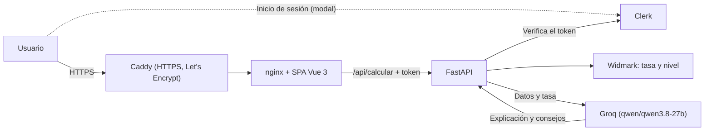

# La Taberna: calculadora de alcohol en sangre

Aplicación web que estima cuánto alcohol tiene una persona en sangre a partir de lo que ha bebido, su peso, su sexo biológico, el tiempo que lleva bebiendo y cómo tiene el estómago. Devuelve la tasa (g/L), un nivel en lenguaje sencillo (sobrio, alegre, borracho o peligroso), las horas hasta volver a 0,0 g/L y una explicación con consejos redactada por una IA.

**Producción:** https://lateberna.manoloplr.com

El resultado es solo orientativo: no sustituye a un alcoholímetro y nunca indica que se pueda conducir.

## Cómo funciona

- **La tasa la calcula siempre el servidor** con la fórmula de Widmark (`api/calculo.py`). El nivel y los avisos salen de reglas fijas.
- **La IA solo explica.** Recibe la tasa ya calculada, el nivel y las horas de espera, y devuelve en JSON una explicación y entre 3 y 4 consejos. Antes la IA también calculaba la tasa, pero con los mismos datos daba números distintos en cada llamada.
- **Si la IA falla** (sin clave, error HTTP, más de 30 s o JSON no válido), la respuesta lleva la misma tasa con una explicación genérica y `origen: "respaldo"`.
- **Hace falta sesión.** El acceso es con Clerk en una ventana modal. El backend verifica el token en cada cálculo y limita a cada usuario a 10 cálculos por minuto y 50 al día.



| Parte | Tecnología |
|---|---|
| Frontend | Vue 3, TypeScript, Vite, `@clerk/vue`, CSS propio (sin Tailwind) |
| Backend | Python 3.12, FastAPI, Pydantic v2, httpx, `clerk-backend-api` |
| IA | Groq, con una API compatible con OpenAI. Modelo `qwen/qwen3.8-27b`, configurable |
| Contenedores | Docker Compose: `backend`, `frontend` (nginx) y `proxy` (Caddy, solo en EC2) |
| Infraestructura | AWS EC2 `t3.micro` con IP elástica, creada con Terraform (`aws/terraform/`) |
| CI | GitHub Actions (`.github/workflows/ci-cd.yml`): pruebas y typecheck |

## Variables de entorno

Copia `.env.example` a `.env` y rellena los valores. `.env` nunca se sube a Git.

| Variable | Para qué sirve |
|---|---|
| `LLM_API_KEY` | Clave del proveedor de IA (Groq: `gsk_...`) |
| `LLM_BASE_URL` | `https://api.groq.com/openai/v1` |
| `LLM_MODEL` | `qwen/qwen3.8-27b` |
| `LLM_REASONING_EFFORT` | Opcional, para modelos con razonamiento |
| `CLERK_SECRET_KEY` | Clave secreta de Clerk (solo el servidor) |
| `VITE_CLERK_PUBLISHABLE_KEY` | Clave publicable de Clerk (frontend) |
| `FRONTEND_ORIGIN` | Origen desde el que se abre la web; Clerk solo acepta tokens emitidos para él |
| `DOMINIO` | Solo en EC2: dominio para el certificado HTTPS |
| `LOG_ARCHIVO`, `LOG_LEVEL`, `APP_ENV` | Registro de errores |

Con el plan gratuito de Groq, el modelo admite 1000 peticiones al día y 8000 tokens por minuto. Cada cálculo tarda alrededor de 0,5 a 1 s.

## Ejecutar en local

```powershell
python -m venv .venv; .venv\Scripts\activate
pip install -r requirements-dev.txt
uvicorn api.index:app --reload        # API en http://localhost:8000

npm install
npm run dev                           # SPA en http://localhost:5173
```

Con `VITE_USE_MOCK=true` el frontend usa una respuesta de ejemplo y no necesita el backend.

## Pruebas

```powershell
pytest api/                           # backend: cálculo, contrato, IA y Clerk simulados
npm test                              # frontend (Vitest)
npm run typecheck
```

Ninguna prueba llama a la IA ni a Clerk reales. GitHub Actions lanza las tres en cada push a `main` y exige al menos un 80 % de cobertura en el backend.

## Docker Compose (local)

```powershell
docker compose up -d --build          # http://localhost:8080
docker compose logs -f backend
docker compose down
```

El backend solo está en la red interna de Docker. nginx sirve la SPA y reenvía `/api` al backend.

## Despliegue en EC2

La guía completa está en [`aws/EC2.md`](aws/EC2.md): Terraform crea la instancia, la IP elástica (52.21.114.192) y el grupo de seguridad, que solo abre los puertos 80 y 443 y el 22 para la IP de administración. La instancia clona este repositorio y se arranca con:

```bash
docker compose -f docker-compose.yml -f docker-compose.aws.yml up -d --build
```

Para actualizarla: `git pull` y el mismo comando.

## Spec Kit

La App 2 se ha especificado con Spec Kit:

- [`.specify/memory/constitution.md`](.specify/memory/constitution.md): principios del proyecto.
- [`specs/001-taberna-app2/`](specs/001-taberna-app2/): especificación, plan, modelo de datos, contrato OpenAPI, tareas y guía rápida.
- [`ERS.md`](ERS.md): especificación de requisitos (versión 0.2), con la trazabilidad de cada requisito a sus pruebas.
- [`docs/COMPARATIVA.md`](docs/COMPARATIVA.md): comparativa entre la App 1 (manual) y la App 2 (Spec Kit + IA).

## Seguridad

- Las claves solo existen en el `.env` del servidor. Ni el frontend ni las respuestas de la API las contienen, y `.env`, `*.pem`, `*.tfstate` y `*.tfvars` están en `.gitignore`.
- A la IA solo se le envían números y valores de listas cerradas, nunca texto libre del usuario.
- Sin token, o con un token no válido, el servidor responde 401 sin llamar a la IA. Si falta la configuración de Clerk, responde 500.
- Límite por usuario: 10 cálculos por minuto y 50 al día (429). Los contadores están en memoria.
- No se guarda ningún dato del usuario entre peticiones.

## Registro de errores

Si la IA falla, la API responde igualmente y anota el motivo:

- **Consola:** en la terminal de uvicorn o en `docker compose logs backend`.
- **Archivo:** en local, los avisos y errores se guardan en `logs/errores.txt` (ignorado por Git). `LOG_ARCHIVO=false` lo desactiva.
- Solo se registra el motivo (por ejemplo «El modelo no respondió a tiempo»), nunca los datos del usuario, la clave ni la respuesta de la IA.

## Autores

Daniel Mouimi y Manuel Palomares.
