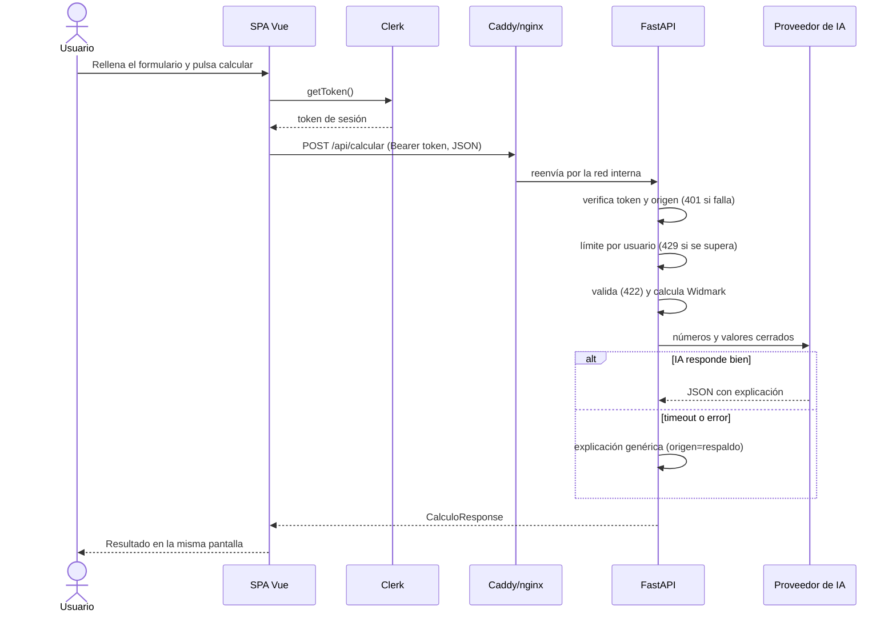

# Plan de implementación: La Taberna (App 2)

**Rama**: `001-taberna-app2` | **Fecha**: 2026-11-02 | **Spec**: [spec.md](./spec.md)

**Entrada**: especificación de `/specs/001-taberna-app2/spec.md`

## Resumen

SPA de una pantalla en Vue 3 que envía una solicitud de cálculo autenticada con Clerk a una API FastAPI. El servidor verifica el token, aplica un límite por usuario, calcula la tasa con Widmark, pide a un LLM (OpenRouter) solo la explicación y devuelve un JSON con esquema estable. Se empaqueta en dos contenedores con Docker Compose y se despliega en una instancia EC2 con Caddy delante para el HTTPS.

## Contexto técnico

**Lenguaje/versión**: Python 3.12 (backend) y TypeScript 6 con Vue 3.5 (frontend)

**Dependencias principales**: FastAPI, Pydantic v2, httpx, python-dotenv, clerk-backend-api; Vue 3, Vite, @clerk/vue y Tailwind CSS

**Almacenamiento**: ninguno (prohibido por la constitución). El límite de peticiones vive en memoria del proceso.

**Pruebas**: pytest con la IA y Clerk simulados; Vitest + @vue/test-utils + jsdom en el frontend

**Plataforma de destino**: contenedores Linux (Docker Compose) en AWS EC2 `t3.micro`, Ubuntu

**Tipo de proyecto**: aplicación web (SPA + API)

**Objetivos de rendimiento**: respaldo en 1 s o menos (p95); espera máxima a la IA de 30 s

**Restricciones**: una pantalla, sin rutas ni persistencia; secretos solo en el backend; HTTPS obligatorio para Clerk en EC2

**Escala**: uso académico, pocos usuarios simultáneos, una sola instancia

## Comprobación de la constitución

| Principio | Cómo lo cumple el plan | Estado |
|---|---|---|
| I. Aplicación mínima | Una sola vista en `App.vue`; Clerk con `SignInButton mode="modal"`; sin router ni base de datos | ⚠️ Quitar `src/views/sign-in.vue`, `sign-up.vue` y `vue-router`, que no se usan |
| II. Reglas, no IA | `api/calculo.py` calcula; `ia.py` solo redacta; respaldo genérico | ✅ |
| III. Secretos en backend | `.env` ignorado, `env_file` en Compose, `.dockerignore`, `.env.example` ficticio | ✅ (falta commitear `.env.example`) |
| IV. Contrato estable | `api/schemas.py` ↔ `src/types/alcohol.ts`; 422 antes de la IA | ✅ |
| V. Pruebas como evidencia | pytest y Vitest con mocks | ⚠️ Faltan las pruebas de 401 de Clerk |
| VI. Revisión humana | Registro de propuestas aceptadas y rechazadas en la comparativa | ⚠️ Pendiente |

## Estructura del proyecto

### Documentación (esta funcionalidad)

```text
specs/001-taberna-app2/
├── spec.md
├── plan.md            # este archivo
├── research.md
├── data-model.md
├── quickstart.md
├── contracts/
│   └── openapi.yaml
└── tasks.md
```

### Código fuente (raíz del repositorio)

```text
api/                      # Backend FastAPI
├── index.py              # App, verificación Clerk, límite por usuario, endpoints
├── calculo.py            # Widmark y niveles (funciones puras)
├── ia.py                 # Cliente del LLM y respaldo genérico
├── schemas.py            # Contrato Pydantic
├── registro.py           # Logger sin datos del usuario
└── test_*.py             # pytest

src/                      # Frontend Vue (una pantalla)
├── App.vue               # Formulario + resultado + Clerk modal
├── components/           # PersonaForm, BebidasLista, ResultadoPanel, ExplicacionPanel, ErrorCard, TabernaDecor
├── services/api.ts       # fetch con Bearer token
├── types/alcohol.ts      # Contrato TypeScript
└── data/catalogo.ts      # Valores por defecto de bebidas

tests/                    # Vitest

docker/
├── backend.Dockerfile    # python:3.12-slim, usuario sin privilegios, HEALTHCHECK
├── frontend.Dockerfile   # build de Vite → nginx
├── nginx.conf            # SPA + proxy /api → backend:8000
└── Caddyfile             # HTTPS automático en EC2

docker-compose.yml        # backend (solo red interna) + frontend (8080)
docker-compose.aws.yml    # añade Caddy (80/443) y quita el puerto del frontend

aws/
├── terraform/            # Par de claves, grupo de seguridad (22 solo IP admin, 80, 443) e instancia
├── user-data.sh          # swap, Docker y clonado del repo
└── EC2.md                # Pasos y datos del despliegue
```

**Decisión de estructura**: se mantiene la estructura de la App 1 (`api/` + `src/` en la raíz) porque Vercel la exige para la App 1 y así ambas comparten contrato y código. La App 2 añade `docker/`, los ficheros de Compose y `aws/`.

## Flujo de una solicitud



## Seguimiento de complejidad

| Desviación | Por qué hace falta | Alternativa más simple descartada porque |
|---|---|---|
| Proxy Caddy como tercer contenedor en EC2 | Clerk exige un origen HTTPS y Let's Encrypt necesita un servidor en 80/443 | Configurar certificados a mano en nginx es más frágil y no se renuevan solos |
| Límite de peticiones en memoria | Protege el crédito de la IA sin añadir una base de datos | Redis o una BD violarían el principio I |
